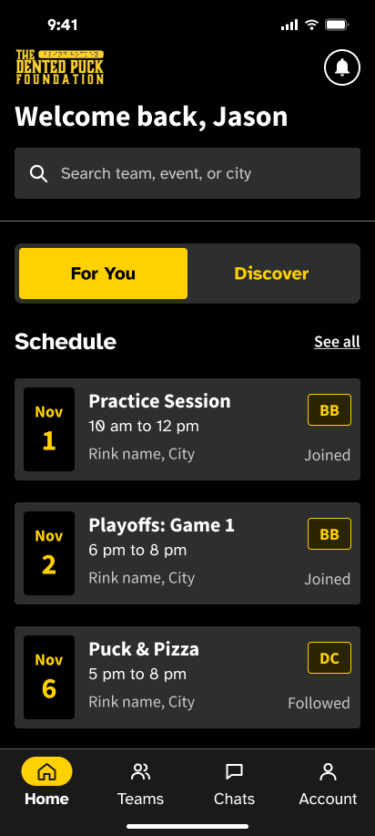
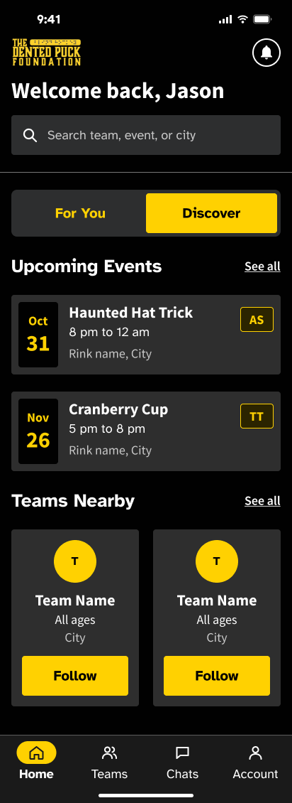
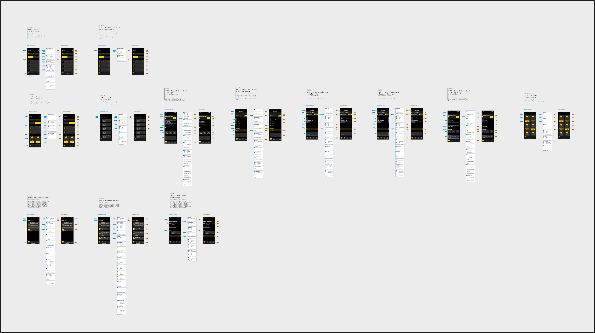

This is an Expo/React Native mobile application. Prioritize mobile-first patterns, performance, and cross-platform compatibility.

## Repository structure on `main`

The application is The Dented Puck Foundation. The inspected `main` uses Expo SDK 58, React Native 0.88, React 19.3, TypeScript, NativeWind v4 / Tailwind CSS v3, and the Firebase JS SDK. Treat `package.json` and the lockfile as the source for dependency versions; the README's version and structure summaries are older than the current code.

```text
src/
  app/
    _layout.tsx             # Root Stack, font loading, global CSS import
    index.tsx               # Current home: Firebase status and development links
    auth/
      _layout.tsx           # Authentication Stack
      index.ts              # Empty placeholder
      login.tsx             # Google sign-in screen (currently web only)
      signup.tsx            # Account creation screen
      verify-email.tsx      # Email verification screen
    invite/
      [token].tsx           # Invite token scaffold; no screen component yet
    tabs/
      teams/
        _layout.tsx         # Teams Stack
        [teamId].tsx        # Team detail screen
        index.tsx           # Comment-only placeholder
        create.tsx          # Empty placeholder
        find.tsx            # Comment-only placeholder
        request-sent.tsx    # Empty placeholder
  components/
    auth/                   # Shared auth fields, buttons, headers, verification UI
    team/                   # Shared team buttons, header, icon, and info card
  firebase/
    index.ts                # Firebase app, auth, Firestore, and Storage exports
  services/
    authService.ts          # Authentication and user profile operations
    teamService.ts          # Team lookup and season label helper
    inviteService.ts        # Empty service placeholder
  types/
    index.ts                # Shared user, team, event, conversation, message models
  utils/
    validation.ts           # Email and password validation
  assets/                   # App icons, splash images, and auth icons
scripts/
  seed.ts                   # Firestore seed script
```

- The `@/*` import alias maps to `src/*` in `tsconfig.json`.
- Styling tokens and font families live in `tailwind.config.js`; Tailwind directives live in `global.css`. The root layout loads Atkinson Hyperlegible regular and bold fonts.
- `app.json` holds Expo configuration. `babel.config.js`, `metro.config.js`, and `postcss.config.js` configure the Expo / NativeWind toolchain.
- `.env.example` lists the required `EXPO_PUBLIC_FIREBASE_*` settings used by `src/firebase/index.ts`.
- A directory named `tabs` exists, but `main` has no `src/app/tabs/_layout.tsx` or shared bottom tab navigator. Several route files are placeholders; their presence does not mean the feature is implemented.

## Figma design reference

Read [figma.md](./figma.md) before working on either home view. It records the supplied Figma page, direct links to the updated **For You** and **Discover** screens, their accessibility annotations, and the gap between the designs and `main`.

Keep Figma observations and home page design notes in `figma.md`. Recheck the live frames before implementing changes, since the design can change independently of this repository.

Use original Figma assets for the dashboard. Exact SVG exports are under `src/assets/home/svg/`, preserving their paths, full canvas, and transparency with `contentsOnly: true` and `useAbsoluteBounds: true`. The six icons are vectors; the wordmark is a cropped bitmap in Figma. `HomeWordmark` uses its original 1200 × 480 image under `src/assets/home/originals/` with the exact crop matrix from the SVG export. Do not trace the logo, upscale an existing PNG, or substitute screenshots. Native SVG icon rendering awaits authorization to install `react-native-svg` and `react-native-svg-transformer` under the dependency restriction below; the icons currently retain the Figma-exported PNG density variants. [figma-assets.json](./src/assets/home/figma-assets.json) records permanent links, node IDs, geometry, and checksums; see [figma.md](./figma.md#image-asset-quality--november-5-2026) for the source details.

## Expo has changed — do not trust your training data

Expo ships breaking changes every SDK release. APIs you remember are likely renamed, moved, or removed. Before writing any code that touches an Expo, EAS, or React Native API:

1. Read the major version of the `expo` package in `package.json`.
2. Fetch the matching versioned docs: `https://docs.expo.dev/versions/v<major>.0.0/`
3. For anything else, fetch https://docs.expo.dev/llms.txt — an index of all Expo docs with corrections to common LLM misconceptions. Follow its links to the specific page you need; never answer from memory.

## Commands

`main` currently tracks `package-lock.json` and uses npm / `npx`.

Use `bunx` instead of `npx` if the project uses bun (`bun.lock` present).

```bash
npx expo install <package>  # ALWAYS use instead of npm/yarn/pnpm/bun add — resolves SDK-compatible versions
npx expo start              # start the dev server
npx expo lint               # lint
npx tsc --noEmit            # typecheck
npx expo-doctor             # diagnose dependency and config issues
npx expo install --fix      # fix incompatible package versions
```

Run lint and typecheck before declaring any task done.

## Navigation & Routing

- Use **Expo Router** for all navigation. Routes live in `src/app/` — every file there is a screen, `_layout.tsx` files define navigators. Keep non-route code (components, hooks, utils) outside `src/app/`.
- Import `Link`, `router`, and `useLocalSearchParams` from `expo-router`.
- Docs: https://docs.expo.dev/router/introduction.md

## Building with EAS

Use EAS to build, sign, and submit the app in the cloud (`eas build`, `eas submit`) and to ship over-the-air updates (`eas update`) — no local Xcode or Android Studio required. Run EAS CLI as `bunx eas-cli <command>` in Bun projects, or `npx eas-cli@latest <command>` otherwise; substitute that for bare `eas` in docs examples.
Docs: https://docs.expo.dev/eas/index.md

## Rules

- If `ios/` and `android/` directories do not exist, they are generated (Continuous Native Generation). Never create or edit them by hand — configure native behavior in `app.json` and config plugins.
- Expo Go only includes its bundled native modules. After adding a library with native code, the app needs a development build: `npx expo run:ios|android` locally, or `eas build --profile development`.
- Prefer recommended Expo modules over third-party libraries, and check your available skills before adding dependencies. Docs: https://docs.expo.dev/versions/latest/index.md

## Current assignment scope — Home Dashboard / For You & Discovery

**November 9 scope cleanup (latest):** The user approved the Home-only ownership plan and explicitly kept **Fake login (dev)** for testing. Retain the five Schedule/two Discover/two nearby previews, approved live adapter and Follow persistence, event search, location, and dev controls. Separate See All screens, Login, Account, Event Detail, Notifications, Find Team, and Team Info remain outside this deliverable. `homeDestinations.ts` wires only the existing Team Info route. See All uses optional `eventList`/`nearbyTeamList`/`announcementList` destinations; absent destinations are visibly and accessibly unavailable. Legacy full-list URLs are redirect-only. Exact full-list/hook/legacy-test drafts and a reapplicable Login patch are preserved in `docs/handoffs/home-scope-2026-11-09/`; Login and authService now match their Git baseline. Do not reintroduce those drafts as Home features. Nearby passes only canonical IDs to Team Info after any Follow write completes; demo IDs never enter its live reader. Team Info's saved Follow display, live announcements, and sibling destinations remain explicit handoffs. Dev login/reset/sign-out, Firebase config/rules, QA records, dependencies, unrelated edits, and historical screenshots are unchanged. 55 focused tests, lint/typecheck, and all-platform export pass; no simulator/browser, backend writes, Notion edits, installs, or commits. See the top of `figma.md` and the handoff README for current behavior and acceptance gaps.

**November 9 live Firebase authorization:** The user authorized cloud QA accounts/events and simulator verification, then explicitly approved live Home wiring, `Users/{uid}.followedTeamIds`, optional coordinates on labeled QA fixtures, and deployment of the tested one-condition profile-role security fix. Normal Home now uses `firebaseHomeService.ts`; earlier production-unavailable notes below are historical. The cloud project is `denton-puck`. Existing users/events/teams were preserved; a dedicated QA region has four teams and 34 events. Credentials and the new-document manifest are ignored under `.sandbox/`; never put test passwords in app code or `EXPO_PUBLIC_*`. `firebase.live.json`, `firestore.rules`, and `firestore.indexes.json` record the deployed configuration. Use `firebase.tests.json` for isolated loopback tests of the live adapter/rules; sandbox tests deliberately use different rules. See `docs/firebase-final-checks.md` and the new top entry in `figma.md` for mappings, authorization, remaining limits, and final validation. No dependencies, Notion changes, or commits.

**November 9 Follow preservation fix:** The user reported disappearing teams/events in normal fake login and requested per-user Firestore persistence rather than event deletion. Nearby now retains followed teams with Unfollow (joined teams remain excluded). Events still move from Discover into Schedule under the existing affiliation rule; all 34 sample event IDs/content are conserved. The default nearby Baltimore set includes the already-followed Dented Crew plus the three previously suggested teams. Normal fake login remains local because it has no Firebase Auth account. Emulator login now atomically updates only `SandboxViewers/{authUid}.followedTeamIds`, reads that value from Firestore, and ignores old device-local sandbox overrides. This request authorizes that narrow emulator preference write; local rules still deny event edits/deletes, profile/other-user writes, viewer creates/deletes, and changes to other viewer fields. Production mappings remain unset. All 45 focused tests and three isolated emulator/native-Auth tests pass, as do lint/typecheck and all-platform export. See `figma.md` for details. No simulator or commit.

**November 9 search follow-up:** The user requested working Home search after checking Notion ownership, and asked for no simulator run. The current Fall 2026 tracker has no separate Home/global-search task. Find Team Page search is assigned to another teammate (Verification); preserve that sibling feature. After the user reported a crash on entry, Home now searches directly inside its existing field/ScrollView, with complete visible fake-login/emulator results for teams, events, venues, and cities, plus Clear/count/loading/error states. It no longer pushes a screen or requests autofocus when the bar is tapped. `/tabs/home/search` remains for deep links. The loader catches synchronous throws as well as rejected reads; the user's exact native crash remains unconfirmed without device logs. The production search adapter remains unset, like the production Home contract. Home's live Notion status is now **In Progress**; Notion was read only. See the latest `figma.md` update for behavior and validation. Commit nothing.

**November 9 scope override:** The user now requests Teams Nearby, working Home scrolling, and at most **two** Discover events (Schedule remains five). Teams Nearby is no longer deferred for this task. They explicitly approved adding the SDK-compatible `expo-location` package for foreground device location and a manual city fallback. All other dependency/backend/Notion/commit restrictions remain. See the November 9 update at the top of `figma.md` for the live design check, behavior, validation, and remaining production integration boundary.

### Authorization and source

The user authorized the revised assignment on **October 30, 2026**. Implement the For You and Discovery dashboard views and update their local design documentation. **Commit nothing.** Do not install dependencies, change Notion, write backend data/schema, or implement sibling features. Preserve unrelated working-tree edits and the October 28 screenshots.

The user authorized continuing with the supplied Figma changes on **November 3, 2026**. Fresh snapshots are under `docs/figma/2026-11-03/`; both earlier snapshot sets and unrelated edits remain preserved. Discover was recreated in Figma: current screen `1739:32476`, reading order `1739:32602`. The October 30 Discover links no longer resolve. See `figma.md` for the live recheck and replacement sibling links.

The live [Home Dashboard - For You & Discovery task](https://app.notion.com/p/405197abf07b80e49483f3c4522720f4) is assigned to Abir Modak, **Sprint 3**, status **Not started**. This supersedes the October 28 For You-only scope and Sprint 0 notes. The [Sprint 3 tracker](https://app.notion.com/p/3f0197abf07b80c3aa3fe8988dec5de1) records November 1–8; that range does not establish an individual task deadline. Notion was read through the School connection and was not modified.

Supporting requirements remain the [PRD](https://app.notion.com/p/eba197abf07b83bd8ea1019c1385fadd) and [home MVP feature](https://app.notion.com/p/581197abf07b8371902e81fb8f0f5a8b). The new task explicitly defers **Teams Nearby**.

### Current acceptance criteria

1. For You lists the schedule for joined and followed teams. Discovery lists regional events from teams the viewer has **neither joined nor followed**. A multi-team event involving any affiliated team is excluded from Discovery.
2. Preview lists contain at most **five events**. When additional matching events exist, See all exposes the full matching set with the same visibility and ordering.
3. Event cards display **team acronyms** in yellow outlined badges. For You displays Joined or Followed; screen readers receive the full team names and relationship, not acronyms alone.
4. Follow the new logo/bell header, search field, selected Home segment, and bottom navigation with **Home selected**. Unknown notification counts must not be represented as zero.
5. Match the designer's iOS/Android accessibility roles, labels, selected state, count announcements, grouped event rows, and focus after switching. Support small screens and large system text without clipping.
6. The task still mentions announcements; the updated For You frame has no inline announcement section. Existing conditional announcement UI is provisional until the notifications/announcement handoff is agreed.
7. The task references `Events`, region, `teamId`, and `isTeamSpecific`. It does not resolve the stored schema, joined/followed representation, or full public-event semantics. Do not invent those mappings.

### Current Figma components and screenshots

Use [figma.md](./figma.md) for the detailed handoff, accessibility callouts, sibling states, and change history. Keep the permanent [original annotated-page link](https://www.figma.com/design/qYrhB6rbv9R8NcdFj7JKTP/Dented-Puck?node-id=641-291&p=f&t=41DuKIE6jIkvFZsC-0) available for future agents.

File key: `qYrhB6rbv9R8NcdFj7JKTP`; annotated page: `641:291`; [current Home section](https://www.figma.com/design/qYrhB6rbv9R8NcdFj7JKTP/Dented-Puck?node-id=1488-24172): `1488:24172`. The former Home section and `1223:*` screen/annotation links were deleted. October 28 PNGs are historical snapshots, not current targets. The new flow notes are marked **In review**.

| Reference | Live Figma | Saved snapshot |
| --- | --- | --- |
| For You | [6100 · 1488:25041](https://www.figma.com/design/qYrhB6rbv9R8NcdFj7JKTP/Dented-Puck?node-id=1488-25041) | [For You PNG](./docs/figma/2026-11-03/home-for-you.png) |
| Discover | [6200 · 1739:32476](https://www.figma.com/design/qYrhB6rbv9R8NcdFj7JKTP/Dented-Puck?node-id=1739-32476) | [Discover PNG](./docs/figma/2026-11-03/home-discover.png) |
| Notification alert | [6110 · 1488:24174](https://www.figma.com/design/qYrhB6rbv9R8NcdFj7JKTP/Dented-Puck?node-id=1488-24174) | [Alert PNG](./docs/figma/2026-11-03/home-notification-alert.png) |
| Annotated Home canvas | [Home · 1488:24172](https://www.figma.com/design/qYrhB6rbv9R8NcdFj7JKTP/Dented-Puck?node-id=1488-24172) | [Full overview PNG](./docs/figma/2026-11-03/home-design-overview.png) |
| For You reading order | [1488:25156](https://www.figma.com/design/qYrhB6rbv9R8NcdFj7JKTP/Dented-Puck?node-id=1488-25156) | Pins are visible on the live Home canvas. |
| Discover reading order | [1739:32602](https://www.figma.com/design/qYrhB6rbv9R8NcdFj7JKTP/Dented-Puck?node-id=1739-32602) | Pins are visible on the live Home canvas. |

| Component / layer | Direct Figma source | Implementation |
| --- | --- | --- |
| Logo / bell header | [1488:25059](https://www.figma.com/design/qYrhB6rbv9R8NcdFj7JKTP/Dented-Puck?node-id=1488-25059) | `HomeHeader`; wordmark export 99 × 40, bell glyph 24 × 24. |
| Greeting / search | [1488:25064](https://www.figma.com/design/qYrhB6rbv9R8NcdFj7JKTP/Dented-Puck?node-id=1488-25064) | Existing Atkinson fonts and field tokens; search remains a sibling destination handoff. |
| For You / Discover segments | [1488:25077](https://www.figma.com/design/qYrhB6rbv9R8NcdFj7JKTP/Dented-Puck?node-id=1488-25077) | `HomeViewTabs`; real Expo Router switching, selected state and focus handoff. |
| Schedule / See all | [1488:25084](https://www.figma.com/design/qYrhB6rbv9R8NcdFj7JKTP/Dented-Puck?node-id=1488-25084) | `HomeSection`; five-item preview and existing full-list route. |
| Joined event row | [1488:25088](https://www.figma.com/design/qYrhB6rbv9R8NcdFj7JKTP/Dented-Puck?node-id=1488-25088) | `EventCard`; date, title, time, location, acronym and Joined status. |
| Followed event row | [1488:25116](https://www.figma.com/design/qYrhB6rbv9R8NcdFj7JKTP/Dented-Puck?node-id=1488-25116) | Same component with Followed status; all labels grouped in one event button. |
| Main navigation | [1488:25130](https://www.figma.com/design/qYrhB6rbv9R8NcdFj7JKTP/Dented-Puck?node-id=1488-25130) | Existing shared bottom tabs; Home selected on both views and nested lists. |





The Discover reference contains Teams Nearby; the implementation omits that section under the task's explicit exception.

<details>
<summary>Notification alert and full annotation overview</summary>




</details>

### Accessibility details

- Search label: **Search team, event, or city**. Its magnifying glass is decorative.
- iOS Home segments have button semantics, selected state, and values **1 of 2** / **2 of 2**. Android uses tabs and a tablist. Switching should keep focus on the newly selected segment.
- A schedule row is one button labeled with title, full date, time, location, full team name, and Joined/Followed. Dates and badges are not separate stops. Discovery rows also include full team names.
- Notifications on iOS use label **Notifications** with a count value; Android includes the count in the label. The bell remains white, with a gold outline/dot for unread items. Unknown count is announced as unavailable; do not fabricate a zero count.
- See all labels identify their list. Decorative navigation icons are hidden and the current bottom tab exposes selected state.
- The designer's references to native iOS/Android widgets describe intended behavior; use the SDK 58 / React Native APIs available in this repository. `ComponentRef<typeof View>` resolves the current view instance type; do not copy outdated `View` instance annotations from older React Native examples.

### Ownership boundaries

| Separate task | Boundary |
| --- | --- |
| [See All Events](https://app.notion.com/p/408197abf07b8030905ee501ef41b8fc) | Full list design, team Filter and nearest-distance Sort, default date order. The existing dashboard pager remains a minimal handoff and does not implement these controls. |
| [Add Teams Nearby](https://app.notion.com/p/408197abf07b80e595edd2b063c1a410) / [See All Nearby Teams](https://app.notion.com/p/405197abf07b80008a44c6032c62e0f5) | Nearby cards, ranking, Follow persistence, and team list. Figma says five nearby teams; the task says six. This conflict does not expand the current assignment. |
| [Event Detail](https://app.notion.com/p/405197abf07b80a28307d15e90db0a18) | Event detail, Follow, Add to calendar, Going/Maybe/Can’t go replies and editing states (6400–6440). |
| [Notifications / Notification Detail](https://app.notion.com/p/405197abf07b80d3bf6dc31f47cec598) | Unread/Read lists, announcement detail and Message Coach. Dashboard supplies a bell destination and count interface; it does not implement these pages. |

### Backend decisions still required

`homeBackendContract` remains **null**. Production signed-in users therefore receive an unavailable message; a working live feed is not complete. An approved adapter must supply:

- Membership collection/ID mappings, joined versus followed identities, active membership semantics, and Firebase UID versus numeric profile identity.
- Region field/value mappings; `teamId` versus `teamIds`; normalized team IDs, names, and optional acronyms; public visibility and the exact meaning of `isTeamSpecific`.
- Query visibility, deterministic ordering, required indexes, and timestamp normalization. Client filtering is not authorization and must not replace scoped queries.
- Announcement storage, team visibility, publication ordering, and notification count ownership.

The normalized display contract now includes `HomeEvent.teams` and `HomeViewer.followedTeamIds`. The existing `readHomeEvent` helper accepts approved team metadata as a separate argument; it does not infer new Firestore fields. `eventBelongsInSection` excludes unknown team metadata, includes affiliated teams in Schedule, and excludes them from Discovery. The adapter remains responsible for `isTeamSpecific` and regional/public visibility policy. Default sources never query every event to guess those mappings.

### Implementation status — uncommitted

- `src/components/home/HomeDashboardScreen.tsx` composes the revised common shell. For You renders Schedule; Discovery renders Upcoming Events. Nearby teams are deferred. Conditional announcements are retained as a provisional, previously implemented requirement.
- `HomeHeader` uses local Figma wordmark/bell exports and existing matching search assets. An optional `HomeDataSource.notificationCount` and `HomeDestinations.notifications` support later integration. Missing routes and unknown counts remain explicit.
- `HomeViewTabs` switches through `/tabs/home` and `/tabs/home/discover`, exposes platform-specific selected states and positions, and requests focus on the selected segment after switching.
- `EventCard` renders all mapped team acronyms and relationship labels, wraps at large text sizes, and keeps a complete screen-reader label. The obsolete event chevron is no longer rendered.
- Existing bounded reads, merge/deduplication, cursors, account-change cleanup, per-section retry, and full-list pagination remain in place. No production schema, backend writes, Notion updates, package installs, or commits were made.
- Font fidelity remains subject to designer confirmation: Figma uses Source Sans Pro in several layers while the application retains installed Atkinson Hyperlegible fonts.

### Validation — October 30, 2026

- `node --test tests/home-updated.test.cjs`: **7 tests passed**, covering joined/followed exclusion, multi-team and unknown metadata, regional query handoffs, preview/pagination boundaries, working segment routes, grouped large-text cards, count labels and downloaded asset geometry. Component rendering uses the installed React DOM server; no test dependency was added.
- The older `tests/home.test.cjs` expectations were updated for the new feed split, but that suite cannot start because the previously used `react-test-renderer` is not installed. Do not report its lifecycle tests as passing in this environment.
- Expo's **web export passed** and included the Discover route and local logo/bell assets.
- Repository lint still fails on the existing top-level invite hook (one error and one unused-variable warning). Typecheck still fails on four existing TextInput ref errors in signup/AuthTextField. No new dashboard lint or TypeScript errors remain.
- Local Node 20.20.2 is below Expo's requested >=22.13.0. Dependencies were not changed to address this environment issue.
- Real-device layout, VoiceOver/TalkBack, and focus during native navigation still need verification. A successful bundle and mocked/static component rendering do not prove native accessibility or a working live backend.

### November 3 implementation follow-up

- Rechecked the live For You and recreated Discover frames plus platform-specific annotations. Refreshed four design snapshots and repaired moved Discover/sibling links in `figma.md`; all prior screenshots remain preserved.
- Corrected the logo/bell header spacing and unread-dot geometry. The bell keeps its 40 × 40 visual circle with hit slop for the touch target. iOS count-increase announcements retain the same account's last known count through refresh; unknown notification status remains distinct from zero.
- Segment navigation now omits stack animations and schedules focus after layout, cancelling the request if the screen blurs first. Long labels, long acronyms, and multi-team badges wrap within the available width. The existing joined/followed visibility rules and backend contract boundary remain unchanged.
- `node --test tests/home-updated.test.cjs`: **10 tests passed**, including focus dispatch/cancellation on the three platform branches, notification announcements across refresh/account changes, and grouped multi-team labels at large text sizes. The older renderer-dependent lifecycle suite still requires its missing package; it was not represented as passing.
- `CI=1 EXPO_NO_TELEMETRY=1 EXPO_NO_DOTENV=1 npx --no-install expo export --platform all --output-dir /tmp/dented-puck-dashboard-2026-11-03`: **passed** for iOS, Android, and web, including local logo/bell assets and the Discover route. This verifies JavaScript/Hermes bundle generation, not native device rendering or accessibility.
- Required lint/typecheck were rerun: lint retains **1 existing invite-hook error and 1 unused-token warning**; TypeScript retains **4 existing auth TextInput ref errors**. No new dashboard diagnostics remain. Node 20.20.2 still produces Expo's unsupported-version warning. Native device/screen-reader validation and approved live Firestore wiring remain incomplete.
- No commits, dependency installs, Notion edits, backend writes, or unrelated source fixes were performed. The pre-existing `package-lock.json` changes were preserved.

### November 5 sandbox authorization and implementation

The user authorized a sandbox with fake Firestore events and a fake dev login to preview progress. This extends the earlier no-backend-write boundary only for the local sandbox. Production backend mappings, cloud data, Notion, dependencies, unrelated edits, and prior screenshots remain unchanged; commit nothing.

- `npm run sandbox` starts the installed Firebase CLI with `firebase.sandbox.json`, seeds the `demo-dented-puck` Auth/Firestore emulators, and starts Expo on port 8082. The normal server on 8081 can remain running. See [docs/sandbox.md](./docs/sandbox.md).
- The dev button signs into a real emulator Auth account (`dev@dentedpuck.test`). The sandbox uses its own named Firebase app and session persistence. It cannot be activated in release builds. The seed is fixed to loopback endpoints and a demo project.
- Emulator-only `SandboxViewers/{uid}` read models supply 8 scheduled and 26 Discover events, a fake unread count, team names/acronyms, joined/followed relationships, and deterministic pagination. These fields do not establish production schema decisions; `homeBackendContract` remains null in normal mode.
- Authenticated app clients can read only their own sandbox profile/feeds and cannot write fixtures. The seed reuses stable IDs and refreshes dates without duplicates. The sandbox bar identifies fake data and provides sign-out. Sibling destinations remain outside scope.
- Validation: 5 sandbox tests and all 10 updated dashboard tests passed. The sandbox integration uses the real Firebase SDK against the running Auth/Firestore emulators, including denied reads/writes and 20 + 6 pagination. An isolated browser session verified dev login, both previews, segment switching, full lists, load-more, sign-out/re-entry, persisted login after reload, and no horizontal overflow at 320px. The launcher's interactive Ctrl+C stopped its services and preserved the existing port-8081 server.
- iOS/Android/web export passed. Required lint/typecheck still report only the existing invite-hook error/warning and four auth TextInput ref errors. The invite issue also emits a development LogBox notice. No native device or screen-reader verification is claimed. Node 20.20.2 still triggers Expo's unsupported-version warning.

### November 5 mobile follow-up and user preference

- The user asked not to open sites/apps for them while they work, and explicitly prioritized mobile. Do not auto-launch browser or Simulator windows, or operate their existing simulator or physical devices. Native checks may use an isolated, headless simulator set and must clean it up afterward.
- `npm run sandbox` now defaults to `--lan`, prints addresses for manual opening, and prefers physical LAN adapters over VPNs/virtual networks. A supplied `EXPO_PUBLIC_FIREBASE_EMULATOR_HOST` also sets Metro's advertised hostname, so one override covers all three mobile service connections.
- The native iPhone run exposed the invite scaffold's unused top-level hook as a LogBox banner covering navigation. That hook was removed without implementing invite functionality. AuthTextField, PasswordField, and signup now use `ComponentRef<typeof TextInput>` for React Native 0.88 refs. This supersedes the earlier lint/typecheck blockers; both checks pass.
- Eight sandbox tests and ten dashboard tests pass. The new tests use Firebase's installed React Native Auth entry point for both platform branches against real local emulators, with an in-memory AsyncStorage boundary to check persistence/restoration. They do not constitute Android device verification. Both native Hermes exports pass.
- A custom background iPhone 16e simulator set (iOS 26.2 / Expo Go 58.0.7) verified dev login, the two feeds, segment switching, full-list navigation/scrolling, and actual native AsyncStorage session storage using the LAN host. No Simulator/browser window was launched for this follow-up. Android device rendering and TalkBack are unverified because no Android runtime is installed. VoiceOver and physical-phone network checks remain pending.
- At the largest iOS accessibility text setting, the dev login button stayed reachable through scrolling, dashboard/navigation labels wrapped, and native sign-out remained operable. Sign-out cleared the real AsyncStorage sandbox session. The custom simulator was shut down and deleted; the user's device set was preserved. Verification PNGs are under `docs/sandbox/2026-11-05/`. These checks are not a native screen-reader review.

### November 8 fake-login entry clarification

- The user clarified that fake login belongs directly on the signed-out prompt inside the normal Expo Go app. `HomeDashboardScreen` and the signed-out full event list now show **Fake login (dev)** in development. The root route opens Home for both normal and sandbox launches; the separate sandbox login screen was removed.
- With the normal Expo server, the button selects a local preview session and the same seed fixtures (8 scheduled / 26 Discover events), without signing into Firebase or changing a real account. The optional sandbox launcher uses its existing emulator Auth/data source through the same button. Production preview entry is blocked, and the production backend contract remains unset.
- Home's provider and full-list account checks recognize the independent local preview session while preserving real-UID checks and cancellation for Firebase reads. **Dev sign out** clears the preview and returns to the Home prompt; regular preview state resets on reload.
- Rechecked both live Figma screen screenshots before the Home change. The signed-in layout, supplied assets, and historical screenshots were preserved. The fake-login control is development tooling; see `figma.md` and `docs/sandbox.md`.
- Eleven updated dashboard tests, three local-preview tests, and eight sandbox tests pass. The native Auth tests now seed their own fixtures before checking upcoming counts, so an emulator left running from an earlier date does not make those tests race stale fixtures. Lint/typecheck and both native Hermes exports pass.
- A disposable headless iPhone 16e (iOS 26.2 / Expo Go 58.0.7) opened the existing normal port-8081 server, displayed the inline button, loaded the sample Schedule on one tap, opened the full list, and returned to the same prompt on dev sign-out. It was shut down and deleted afterward. No browser/Simulator window, existing user simulator, or physical device was operated. Native proof is saved under `docs/sandbox/2026-11-08/`. Android device and screen-reader validation remain pending.

### November 9 scrolling, Teams Nearby, and location

- Both Home views use an explicitly bounded ScrollView. Discover previews two events and two nearby team panels, with working See all routes. Nearby cards use the existing team initials avatar and adapt to one column on small screens/large text. Follow persists per fake UID in local AsyncStorage and updates both event feeds without leaving Discover.
- The user authorized `expo-location` after being told no device location was previously read. SDK 58 installed `~58.0.20`; the lockfile preserves pre-existing package entries. Foreground location is requested on tap, with denial/services/timeout handling and a manual city selector. Fake login defaults to a labeled Baltimore demo location; opting into device location uses returned coordinates. A 100 km development radius filters Discover events/teams; team ranking uses calculated distance. Location remains in memory; no background tracking or production location writes were added.
- Emulator-only fixture coordinates and team metadata support local preview and sandbox modes. The sandbox merges its two existing authorized fixture streams when local follows change. Production `homeBackendContract` remains null: real location queries, schema mappings, and Follow persistence still require approval/integration. Nearby results outside the sample area may be empty.
- Lint/typecheck, 26 focused tests, three emulator/native-Auth tests, and iOS/Android/web export pass. The first concurrent integration attempt had a transient gRPC timeout; final sequential integration passed, including Follow and merged-feed assertions. The renderer-dependent legacy suite was not run.
- A disposable headless iPhone verified actual swipes, nearby panels, See all, Follow updates/native storage, OS location permission denial/manual fallback, and current device coordinates. A simulator-only Frederick location changed the nearest team/distance as expected. Evidence is under `docs/sandbox/2026-11-09/`; live Figma snapshots are under `docs/figma/2026-11-09/`. Android device rendering, screen readers, and physical GPS remain pending. The test simulator/Metro server were cleaned up, existing services/devices were preserved, and nothing was committed.
