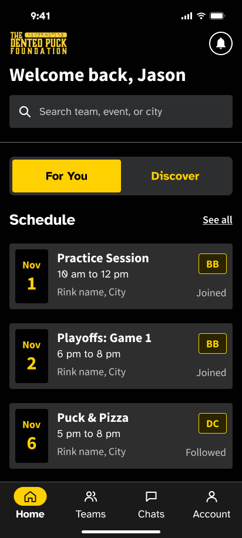
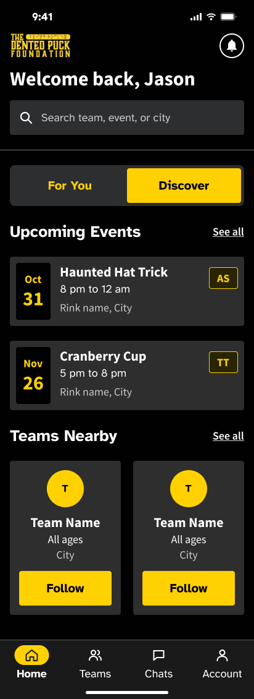
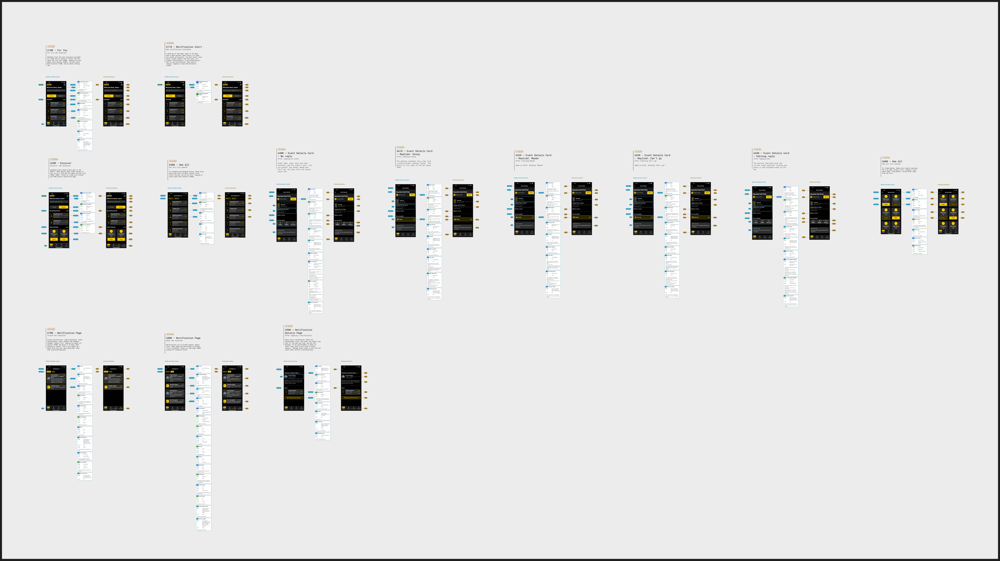

# Dented Puck Figma reference

## Committed Home scope

Home uses Firebase Auth and the live `firebaseHomeService.ts` adapter for profiles, memberships, events, teams, search, and per-user Follow preferences. Discovery uses foreground device coordinates from `expo-location`; it has no preset city selector or default coordinates. Schedule shows up to five events, Discover up to two events, and Nearby up to two teams. Missing optional team/event coordinates remain missing; no location is inferred.

Development login, sample feeds, local Follow storage, emulator app modes, the sandbox bar, and their scripts/screenshots are local-only and are excluded from this branch's committed app. The live cloud QA records and production security rules/indexes are unchanged.

The existing Login screen offers Google sign-in on web only. A restored Firebase Auth session can load Home on mobile; a new native sign-in requires the separately owned Login integration. Announcement data/counts and optional sibling destinations remain unavailable until supplied. The implementation notes below record earlier design checks; this current scope supersedes their older backend/scope status.

## Current source — November 3, 2026

- [Original annotated-page link](https://www.figma.com/design/qYrhB6rbv9R8NcdFj7JKTP/Dented-Puck?node-id=641-291&p=f&t=41DuKIE6jIkvFZsC-0). File key: `qYrhB6rbv9R8NcdFj7JKTP`; annotated page: `641:291`.
- [Current Home section](https://www.figma.com/design/qYrhB6rbv9R8NcdFj7JKTP/Dented-Puck?node-id=1488-24172): `1488:24172`.
- The former Home section (`1223:16925`), its screen frames, and its annotation groups no longer resolve. Use the new links below. The October 28 PNGs are preserved as historical references.
- The current screens were inspected through live design context and screenshots. The designer's flow notes are marked **In review**. Saved PNGs are snapshots; reopen the permanent Figma links before future work.
- The updated [Notion assignment](https://app.notion.com/p/405197abf07b80e49483f3c4522720f4) is **Home Dashboard - For You & Discovery**, assigned to Abir, Sprint 3, status Not started. Teams Nearby is explicitly deferred.

The live designs were rechecked on November 3. For You and the alert state retain their October 30 frame IDs and appearance. Discover was recreated as `1739:32476`, with reading order at `1739:32602`; the October 30 `1488:26038` / `1488:26164` links no longer resolve. Its Upcoming Events layout and acronym badges remain the target, while Teams Nearby remains deferred. The sibling event/list frames were also moved; the links below now point to their replacement nodes. The Notion status above is the October 30 handoff, not a new task-status check.

## What changed from October 28

1. Both Home views now have the foundation wordmark and a notifications bell above the greeting. A separate alert state adds a gold outline and dot to the white bell.
2. For You has one **Schedule** list covering joined and followed teams. Its separate Upcoming Events heading was removed; Puck & Pizza now appears in Schedule with a Followed label.
3. Yellow outlined badges show team acronyms such as BB and DC, replacing the generic Team label. For You also shows Joined or Followed beneath each badge. Discovery events have acronym badges instead of chevrons.
4. Discover retains Upcoming Events; Top Teams was renamed Teams Nearby, with All ages in the examples. Its complete frame is taller (412 × 1130).
5. The Home section now includes full event-list, notification, announcement-detail, and five event-detail/RSVP states, each with stamps and reading-order counterparts.
6. Accessibility notes now distinguish iOS segmented buttons and Android tabs, announce notification counts, and include full team names and membership status in event-row labels.

## Current home frames and screenshots

| Reference | Permanent Figma link | Local screenshot |
| --- | --- | --- |
| 6100 — For You, 412 × 917 | [1488:25041](https://www.figma.com/design/qYrhB6rbv9R8NcdFj7JKTP/Dented-Puck?node-id=1488-25041) | [6100 — For You, 412 × 917 PNG](./docs/figma/2026-11-03/home-for-you.png) |
| 6200 — Discover, 412 × 1130 | [1739:32476](https://www.figma.com/design/qYrhB6rbv9R8NcdFj7JKTP/Dented-Puck?node-id=1739-32476) | [6200 — Discover, 412 × 1130 PNG](./docs/figma/2026-11-03/home-discover.png) |
| 6110 — Notification alert | [1488:24174](https://www.figma.com/design/qYrhB6rbv9R8NcdFj7JKTP/Dented-Puck?node-id=1488-24174) | [6110 — Notification alert PNG](./docs/figma/2026-11-03/home-notification-alert.png) |
| Home section with accessibility callouts and ordering pins | [1488:24172](https://www.figma.com/design/qYrhB6rbv9R8NcdFj7JKTP/Dented-Puck?node-id=1488-24172) | [Home section with accessibility callouts and ordering pins PNG](./docs/figma/2026-11-03/home-design-overview.png) |

The overview is a reduced canvas export showing the surrounding annotations. Open the live links to read small callouts; the clean screen PNGs deliberately exclude those overlays.

Notification alert state

Full Home design and annotation overview

## Components and interaction references

Most building blocks below are ordinary Figma frames, not published reusable components. They map to shared application components outside `src/app/`.

| Building block | Permanent Figma layer link | Behavior / dimensions |
| --- | --- | --- |
| Logo and notifications header | [1488:25059](https://www.figma.com/design/qYrhB6rbv9R8NcdFj7JKTP/Dented-Puck?node-id=1488-25059) | The exported wordmark slot is 99 × 40; the bell glyph is 24 × 24 inside a 40 × 40 outlined circle. Touch targets may extend beyond the visual circle. |
| Wordmark image | [1488:25060](https://www.figma.com/design/qYrhB6rbv9R8NcdFj7JKTP/Dented-Puck?node-id=1488-25060) | Use the downloaded node export, preserving its crop and aspect ratio. |
| Bell icon | [1488:25063](https://www.figma.com/design/qYrhB6rbv9R8NcdFj7JKTP/Dented-Puck?node-id=1488-25063) | White icon; gold outline and dot only when a positive unread count is known. |
| Greeting and search | [1488:25064](https://www.figma.com/design/qYrhB6rbv9R8NcdFj7JKTP/Dented-Puck?node-id=1488-25064) | Greeting, 380 × 56 search input, divider. Search behavior has no assigned backend contract. |
| For You / Discover control | [1488:25077](https://www.figma.com/design/qYrhB6rbv9R8NcdFj7JKTP/Dented-Puck?node-id=1488-25077) | 380 × 66 container; selected segment yellow with dark text. |
| Schedule heading / See all | [1488:25084](https://www.figma.com/design/qYrhB6rbv9R8NcdFj7JKTP/Dented-Puck?node-id=1488-25084) | Five-item preview; See all uses the same scope and ordering as the full list. |
| Joined-team event card | [1488:25088](https://www.figma.com/design/qYrhB6rbv9R8NcdFj7JKTP/Dented-Puck?node-id=1488-25088) | 380 × 112 example. Date, title, time, location, acronym, Joined status. |
| Followed-team event card | [1488:25116](https://www.figma.com/design/qYrhB6rbv9R8NcdFj7JKTP/Dented-Puck?node-id=1488-25116) | Same row pattern; DC acronym and Followed status. |
| Main bottom navigation | [1488:25130](https://www.figma.com/design/qYrhB6rbv9R8NcdFj7JKTP/Dented-Puck?node-id=1488-25130) | Home selected for both Home views and nested lists. Safe areas remain platform-owned. |
| Discovery main content | [1739:32511](https://www.figma.com/design/qYrhB6rbv9R8NcdFj7JKTP/Dented-Puck?node-id=1739-32511) | Upcoming Events for teams outside the joined/followed sets; Teams Nearby is outside the current assignment. |

The frames use black `#010101`, card `#2E2E2E`, navigation `#1A1A1A`, field `#2D2E2F`, and gold `#FFD101`. Reuse the existing tokens. Figma mixes Source Sans Pro and Atkinson Hyperlegible; the application retains its installed Atkinson fonts pending typography confirmation. Reference dimensions do not justify fixed heights that clip large system text.

## Accessibility and flow notes

- [For You flow](https://www.figma.com/design/qYrhB6rbv9R8NcdFj7JKTP/Dented-Puck?node-id=1488-26027): Schedule includes joined and followed teams; See all opens 6300, an event opens 6400, and the bell opens 6700.
- [Notification alert flow](https://www.figma.com/design/qYrhB6rbv9R8NcdFj7JKTP/Dented-Puck?node-id=1488-26028): A gold dot/outline means unread notifications. The spoken count distinguishes zero from a positive count.
- [For You reading order](https://www.figma.com/design/qYrhB6rbv9R8NcdFj7JKTP/Dented-Puck?node-id=1488-25156): Use the ordering counterpart and its surrounding pins on the Home canvas.
- [Discover reading order](https://www.figma.com/design/qYrhB6rbv9R8NcdFj7JKTP/Dented-Puck?node-id=1739-32602): Use the ordering counterpart and surrounding pins, including the separately owned nearby-team controls.
- [Notifications, iOS](https://www.figma.com/design/qYrhB6rbv9R8NcdFj7JKTP/Dented-Puck?node-id=1488-26365): Button label Notifications; count in the spoken value. Unknown counts must not be presented as zero.
- [Notifications, Android](https://www.figma.com/design/qYrhB6rbv9R8NcdFj7JKTP/Dented-Puck?node-id=1488-26366): Include the count in the button label. Updated unread notes require polite announcements.
- [Selected Home segment, iOS](https://www.figma.com/design/qYrhB6rbv9R8NcdFj7JKTP/Dented-Puck?node-id=1488-26367): Button semantics, selected state, and position (1 of 2 or 2 of 2).
- [Selected Home segment, Android](https://www.figma.com/design/qYrhB6rbv9R8NcdFj7JKTP/Dented-Puck?node-id=1488-26368): Tab semantics and selected state. Preserve focus on the selected segment after switching.
- [Event accessibility label](https://www.figma.com/design/qYrhB6rbv9R8NcdFj7JKTP/Dented-Puck?node-id=1488-26364): One button for the entire row: title, full date, time, location, full team name, and Joined/Followed when applicable. Dates and badges are not independent stops.
- [Discover flow](https://www.figma.com/design/qYrhB6rbv9R8NcdFj7JKTP/Dented-Puck?node-id=1739-32475): Public discovery events; nearby teams and Follow controls belong to a separate task.

Search's label is “Search team, event, or city”. “See all, Schedule” is the Schedule control's label. Decorative icons are hidden from the accessibility tree. Confirm current React Native APIs before translating the platform-specific notes into code.

## Sibling screens and ownership

| Screen | Live frame | Boundary |
| --- | --- | --- |
| 6300 — See All Events | [1739:32184](https://www.figma.com/design/qYrhB6rbv9R8NcdFj7JKTP/Dented-Puck?node-id=1739-32184) | Separate See All Events task specifies team filtering and distance sorting, with date as the default. |
| 6400 — Event detail, no reply | [1739:32772](https://www.figma.com/design/qYrhB6rbv9R8NcdFj7JKTP/Dented-Puck?node-id=1739-32772) | Separate Event Detail task: Follow, calendar, location, RSVP, and coach note. |
| 6410 — Going | [1739:32981](https://www.figma.com/design/qYrhB6rbv9R8NcdFj7JKTP/Dented-Puck?node-id=1739-32981) | Selected reply and edit control. |
| 6420 — Maybe | [1739:33179](https://www.figma.com/design/qYrhB6rbv9R8NcdFj7JKTP/Dented-Puck?node-id=1739-33179) | Selected reply and edit control. |
| 6430 — Can’t go | [1739:33377](https://www.figma.com/design/qYrhB6rbv9R8NcdFj7JKTP/Dented-Puck?node-id=1739-33377) | Selected reply and edit control. |
| 6440 — Editing reply | [1739:33575](https://www.figma.com/design/qYrhB6rbv9R8NcdFj7JKTP/Dented-Puck?node-id=1739-33575) | Restores the three options. |
| 6600 — See All Teams | [1739:31927](https://www.figma.com/design/qYrhB6rbv9R8NcdFj7JKTP/Dented-Puck?node-id=1739-31927) | Separate nearby-teams task. |
| 6700 — Unread notifications | [1488:25846](https://www.figma.com/design/qYrhB6rbv9R8NcdFj7JKTP/Dented-Puck?node-id=1488-25846) | Separate notifications task. |
| 6800 — Read notifications | [1488:24648](https://www.figma.com/design/qYrhB6rbv9R8NcdFj7JKTP/Dented-Puck?node-id=1488-24648) | Separate notifications task. |
| 6900 — Notification detail | [1488:24856](https://www.figma.com/design/qYrhB6rbv9R8NcdFj7JKTP/Dented-Puck?node-id=1488-24856) | Announcement content, linked event, and Message Coach action. |

The [See All Events task](https://app.notion.com/p/408197abf07b8030905ee501ef41b8fc), [Event Detail task](https://app.notion.com/p/405197abf07b80a28307d15e90db0a18), and [Notifications task](https://app.notion.com/p/405197abf07b80d3bf6dc31f47cec598) remain separate. Nearby-team counts conflict: Figma's note says five, while the [Add Teams Nearby task](https://app.notion.com/p/408197abf07b80e595edd2b063c1a410) says six. That section is explicitly deferred in the current dashboard task.

The dashboard task still mentions announcements, but the current For You frame has no inline announcement section. The existing conditional announcement UI remains provisional until the announcement/notifications handoff is agreed.

## Implementation and remaining integration

- Routes: `src/app/tabs/home/index.tsx` (For You), `discover.tsx` (Discover), and the existing `schedule.tsx` full-list route. Home remains selected in the shared bottom navigation.
- Shared `HomeDashboardScreen`, `HomeHeader`, `HomeViewTabs`, and `EventCard` compose the current layout. Discovery omits Teams Nearby under the explicit Notion scope exception.
- Team display data and joined/followed IDs are normalized adapter inputs, not newly invented stored fields. `src/utils/homeEvents.ts` includes affiliated events in Schedule and excludes them from Discovery, including events with multiple teams.
- `homeBackendContract` remains unset. The production data layer still needs approved membership, region, event-team, public visibility, `isTeamSpecific`, and announcement mappings and indexes. No backend data or schema was written.
- Optional notification-count and destination interfaces support the bell. Unknown status is exposed honestly, and missing sibling routes remain unavailable.
- Downloaded logo and bell exports are local PNGs. Existing matching search and navigation assets are reused; screenshots are documentation assets only.
- Device rendering, VoiceOver/TalkBack, transition focus, and exact typography still require verification. Component tests and a web export do not establish native accessibility approval.

### November 3 follow-up

Fresh For You, Discover, notification-alert, and annotated-canvas snapshots are saved under `docs/figma/2026-11-03/`. The October 28 and October 30 exports are preserved. All screenshots in the current tables above refer to this new snapshot set.

The header now preserves the design's 40 × 40 bell circle within its original spacing, with an expanded touch area that does not move the visual glyph. The unread dot uses the inspected 9 × 9 geometry. iOS count-increase announcements retain the last known count through refresh and compare counts only within the same account; unknown status is never treated as zero. Home segment routes switch without a stack animation; a cancellable request on the next frame places focus on the selected control, preserving the iOS button/value and Android tab semantics. Segment text, multiple-team badges, and long acronym badges can wrap within small-screen layouts.

Ten focused tests pass, including focus dispatch/cancellation, notification announcements across refresh/account changes, and a mixed-team row at large text sizes. Those tests exercise mocked host controls, not VoiceOver/TalkBack on a device. Production membership/region/event/announcement mappings and sibling destinations remain pending as described above.

The all-platform Expo export passed for iOS, Android, and web, including the local logo/bell assets and Discover route. Repository lint/typecheck still report the pre-existing invite hook and four auth TextInput ref errors, with no new dashboard diagnostics. Export and static tests do not establish native visual or screen-reader approval.

## Image asset quality — November 5, 2026

The user reported that the previous **1×, 2×, 3×, and 4×** PNG exports still appeared blurry and requested the full exact assets. The seven exact Figma SVG exports are now saved under `src/assets/home/svg/`, with unchanged paths, colors, and canvases. The six icons are actual vectors. The wordmark SVG contains a bitmap; exporting it as SVG does not turn the artwork into vectors.

`HomeWordmark` now renders the original uploaded **1200 × 480** bitmap from `src/assets/home/originals/foundation-logo.png`, preserving Figma's 99 × 40 crop and image-to-pattern matrix `[0.00126147, 0, 0, 0.003125, -0.0321101, -0.25]`. Its SHA-1 matches Figma image hash `54521fe89cadc2407605c4c969dbccacf92ff485`. This avoids an intermediate smaller raster export. The Style Guide logos (`329:3` and `329:5`) are also bitmap rectangles, with 447 × 447 source images. No vector logo source was found in those references; unlimited logo sharpness requires original vector artwork from the designer.

**Pending:** rendering the six SVG icons directly requires `react-native-svg` and `react-native-svg-transformer`, which are not installed. `AGENTS.md` explicitly prohibits dependency installation, so that exception has been requested. Until authorized, the application icons continue using their existing Figma PNG density variants. The vector files are ready but are not yet wired into the app. Preserve them as original sources; do not manually copy their path data into components.

| Asset | Direct Figma source | Display size | 4× export |
| --- | --- | --- | --- |
| Foundation wordmark | [1488:25060](https://www.figma.com/design/qYrhB6rbv9R8NcdFj7JKTP/Dented-Puck?node-id=1488-25060) | 99 × 40 | 396 × 160 |
| Notifications bell | [1488:25063](https://www.figma.com/design/qYrhB6rbv9R8NcdFj7JKTP/Dented-Puck?node-id=1488-25063) | 24 × 24 | 96 × 96 |
| Search | [1488:25072](https://www.figma.com/design/qYrhB6rbv9R8NcdFj7JKTP/Dented-Puck?node-id=1488-25072) | 24 × 24 | 96 × 96 |
| Home | [1488:25133](https://www.figma.com/design/qYrhB6rbv9R8NcdFj7JKTP/Dented-Puck?node-id=1488-25133) | 24 × 24 | 96 × 96 |
| Teams | [1488:25138](https://www.figma.com/design/qYrhB6rbv9R8NcdFj7JKTP/Dented-Puck?node-id=1488-25138) | 24 × 24 | 96 × 96 |
| Chats | [1488:25146](https://www.figma.com/design/qYrhB6rbv9R8NcdFj7JKTP/Dented-Puck?node-id=1488-25146) | 24 × 24 | 96 × 96 |
| Account | [1488:25151](https://www.figma.com/design/qYrhB6rbv9R8NcdFj7JKTP/Dented-Puck?node-id=1488-25151) | 24 × 24 | 96 × 96 |

The table's 4× sizes describe the earlier PNG exports, which remain preserved. Exact SVG filenames match the asset names: `foundation-logo.svg`, `notification-bell.svg`, `search.svg`, `home.svg`, `teams.svg`, `chats.svg`, and `account.svg`. Figma's `exportAsync` uses `contentsOnly: true` and `useAbsoluteBounds: true` to exclude surrounding backgrounds. No asset has been traced, locally enlarged, recolored, or recompressed.

[figma-assets.json](./src/assets/home/figma-assets.json) records permanent source links, node IDs, dimensions, export settings, crop geometry, and SHA-256 checksums for the 28 PNG density exports, seven exact SVGs, and original bitmap. Historical documentation screenshots and the unused legacy chevron are not rendered as application assets.

Verified all **36** file checksums, seven SVG viewBoxes, vector-only icon contents, and equality between the logo SVG's embedded bitmap and the original uploaded bytes. The ten focused dashboard tests pass, including the original logo source, exported crop geometry, and accessibility grouping. The all-platform export passes for iOS, Android, and web and includes the original 415 KB logo bitmap. Required lint/typecheck still report the existing invite-hook and four auth TextInput ref errors; there are no new dashboard diagnostics. Native SVG icon rendering and native visual verification remain pending.

## Historical snapshots

The unchanged October 28 snapshots remain under `docs/figma/`: `home-for-you.png`, `home-discover.png`, their annotation exports, and their reading-order exports. They show the former Schedule/Upcoming Events split and generic Team badges. Their old Figma node IDs were deleted, so they must not be used as the current implementation target.

The October 30 snapshot set remains under `docs/figma/2026-10-30/`. It records the first logo/bell and joined/followed handoff, including the former Discover node locations.

See [AGENTS.md](./AGENTS.md) for current scope, backend decisions, and validation results.
