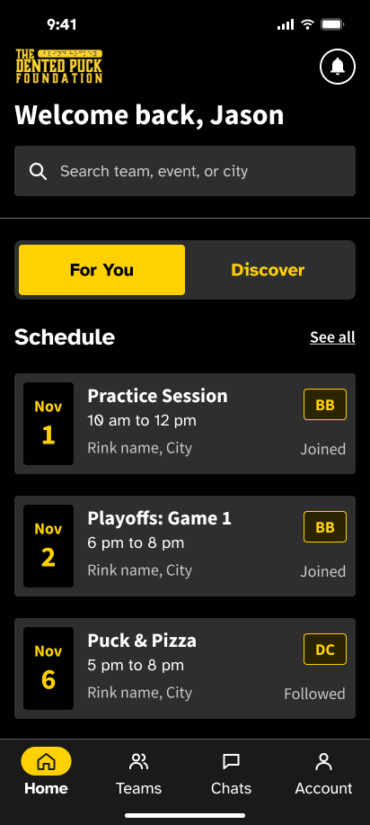
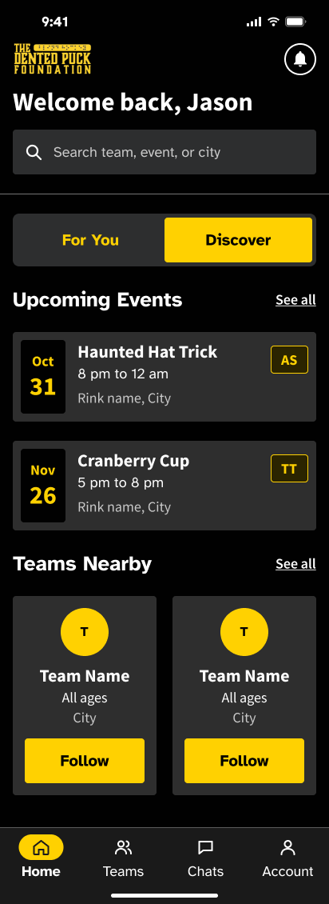
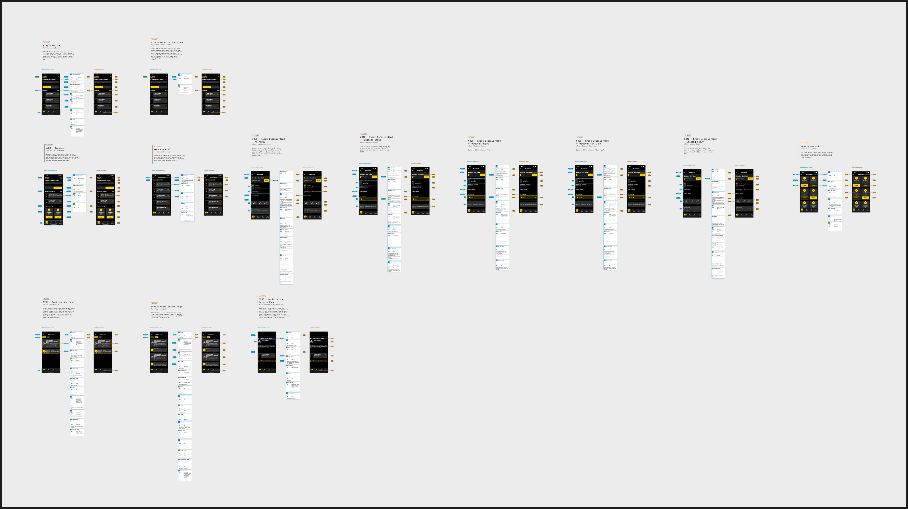

# Dented Puck Figma reference

## Search expands from the original bar — November 9, 2026

The user clarified that search should use Home's original bar and feel seamless. This supersedes the bottom-sheet entry below. Rechecked live For You `1488:25041` and Discover `1739:32476`; their original search position, icon, placeholder, and dark field remain the reference. No separate search-screen or sheet design is being added.

- The original Home field is now the editable input. Focusing it reveals the existing event filters and results beneath it with a short upward fade. The logo, greeting, field, and bottom navigation remain in the same screen. No route push, replacement input, modal, extra title, or filter-description paragraph is involved. Cancel restores the selected Home feed; Android Back and VoiceOver escape also close search.
- Home and search share one virtualized list. Its header remains an element with stable component types, and Android's refresh wrapper stays mounted while disabled for search, preserving the focused field. Keyboard insets, Clear, all three filters, location, loading/retry/count announcements, and the full visible event catalog remain available. The catalog loads only while search is open. Account changes reset the query/filter and skip outgoing animation. Motion uses the existing Reanimated dependency and respects Reduce Motion.
- `/tabs/home/search` now redirects to the same Home search interaction. The former sheet options and dedicated page are removed. Existing Home transitions, preview limits, scope boundaries, and unrelated edits remain preserved.

Validation: **56 focused tests pass**, with the emulator-gated live-adapter test skipped. Lint, typecheck, and iOS/Android/web exports pass. Host checks cover both native branches, in-place search entry without navigation, one input/scroll container, filters, Clear, Cancel/back/escape, account isolation, dormant catalog reads, and loading/retry feedback. Native input continuity, keyboard layout, animation appearance, and screen-reader traversal were not device-verified. No simulator/browser window, dependency install, backend/Notion change, or commit.

## Smooth Home updates — November 9, 2026

The user requested clean transitions whenever For You or Discover updates. Rechecked live For You `1488:25041` and Discover `1739:32476` through Figma design context and screenshots. The supplied shell, original assets, card styling, preview limits, and segment semantics remain the reference. The new motion implements the user's request; it is not a designer-supplied motion specification.

- Event, nearby-team, and announcement rows retain stable record keys. Added/removed rows fade in/out over 180/100 ms; row positions and section dimensions ease over 220 ms through the already-installed Reanimated library. Unchanged rows stay mounted during refreshes. Event/nearby loading, empty, and error transitions use the same treatment. The existing segment fade/slide and moving gold indicator remain.
- Follow, reset, and location updates retain the current content while replacements load and no longer activate the top refresh control. Only a pull-to-refresh gesture shows that control; success and failure both stop it. The header, selected segment, bottom navigation, and existing scroll container stay mounted.
- Motion respects the system Reduce Motion setting. Animation scopes are keyed to the session, with exiting animations skipped when leaving Home or changing accounts so old account content is cleared immediately. Existing grouped accessibility labels and focus handoffs remain.

Checked the [Expo SDK 58 Reanimated reference](https://docs.expo.dev/versions/v58.0.0/sdk/reanimated/) and the library's [layout transition](https://docs.swmansion.com/react-native-reanimated/docs/layout-animations/layout-transitions/), [presence animation](https://docs.swmansion.com/react-native-reanimated/docs/layout-animations/entering-exiting-animations/), and [Reduce Motion](https://docs.swmansion.com/react-native-reanimated/docs/guides/accessibility/) guidance. No package installation or configuration change was needed.

Validation: **56 focused tests pass**, including retained content, background versus pull refresh, location changes, failed-refresh cleanup, account isolation, preview limits, search, and accessibility feedback. The emulator-gated live-adapter test was skipped; no emulator/cloud write was performed. Lint, typecheck, and iOS/Android/web exports pass. Host tests mock the animation runtime; exports verify bundling, not native animation appearance or screen-reader behavior. No simulator/browser was opened, following the user's visual-review preference. Nothing was committed; historical screenshots and unrelated edits remain preserved.

## Search bottom sheet — November 9, 2026

The user requested removing the explanatory text beneath the search filters and opening search smoothly from the bottom over Home. Rechecked live For You `1488:25041` and Discover `1739:32476`; the original Home search entry and assets remain unchanged. This interaction follows the user's request; no separate search-sheet Figma frame was supplied.

- Removed the filter-specific helper paragraph. Search now uses an Expo Router `formSheet` with a bottom slide, rounded corners, a grabber, and a 94% detent so Home remains behind it. Anchoring the Home stack also retains a background for direct search links.
- Search has a persistent, wrapping title and accessible **Close search** button inside the sheet because Android form sheets do not display native stack headers. Closing returns to the prior Home view, with a Home fallback for entry without history; VoiceOver escape uses the same action. The existing filters, location controls, keyboard behavior, and results remain available.
- Checked the [Expo SDK 58 reference](https://docs.expo.dev/versions/v58.0.0/) and [Router modal/sheet documentation](https://docs.expo.dev/router/advanced/modals/) against the installed Router types. All **9 search tests**, lint, and typecheck pass. The existing UI check covers both mocked native platforms, removed helper text, Close/back behavior, direct-entry fallback, filters, typing, and account isolation. The animation and native sheet layout were not device-verified. No simulator/browser was opened, dependencies installed, backend/Notion changes made, or commits created.

## Home scope cleanup — November 9, 2026

The user approved the ownership plan, then explicitly retained **Fake login (dev)** for testing. This entry supersedes earlier full-list and native-login behavior below. Rechecked live For You `1488:25041` and Discover `1739:32476`; fresh reference snapshots are in [2026-11-09-scope](./docs/figma/2026-11-09-scope/). The supplied assets, Home shell, event cards, animation, accessibility semantics, five Schedule/two Discover previews, and two nearby cards remain.

- Home keeps its See all controls, but receives destinations through `HomeDestinations.eventList`, `nearbyTeamList`, and `announcementList`. The default configuration leaves these unset because the separate screens are absent. Controls are visibly marked **Unavailable**, disabled, and have list-specific accessible labels/hints. They do not open a substitute list or reuse event search. Old `/tabs/home/schedule` and `/tabs/home/nearby-teams` links only redirect to the corresponding Home view or an explicitly supplied sibling route.
- The full-list screens, their pagination hook, and the obsolete renderer-dependent suite are preserved as exact text drafts in [the scope handoff](./docs/handoffs/home-scope-2026-11-09/README.md), outside application and test discovery. The original Login/auth-service additions are preserved in `login.patch`; those two source files now match the existing Git baseline. The Account tab no longer substitutes the login page. Native email/password login remains the Login task owner's integration dependency; the approved live Home adapter, existing Auth persistence, deployed configuration/rules, and QA data remain intact.
- Nearby card descriptions now link to the existing `/tabs/teams/[teamId]` using only the canonical team document ID. Follow/Unfollow remains a separate action. Navigation is disabled during the Follow write, so the shared per-user preference has been saved before the handoff. Demo card navigation is disabled because fixture IDs do not exist in the separate Team Info screen's live reader; fake-login Follow and search remain usable. Team Info itself is unchanged: its Follow control is a placeholder and does not display the saved relationship. That remaining acceptance dependency belongs to its owner.
- **Fake login (dev)**, sample data, Reset fake follows, Dev sign out, search, manual/device location, and per-user Follow persistence are retained. Event search remains the user's separately authorized Home extension; it adds no See All team filtering/distance sorting, directory, RSVP, or calendar implementation. Conditional Home announcements remain provisional because the live announcement source/placement is unresolved. Notification count remains unknown for live accounts.

Validation: **55 focused tests**, lint/typecheck, and iOS/Android/web export pass. Checks cover unavailable versus supplied sibling routes, legacy-link redirects, canonical Team Info IDs, demo isolation, waiting for Follow before navigation, five/two preview limits, release-gated fake login, persisted follows, feed conservation, account isolation, search, and accessibility feedback. Exact draft checksums and the reapplicable Login patch were verified. No simulator, browser, physical device, package install, cloud/emulator write, rules deployment, Notion edit, or commit was performed. Native screen-reader/device acceptance remains unverified. See the [scope handoff](./docs/handoffs/home-scope-2026-11-09/README.md) for the checklist and remaining owners.

## Live Firebase integration — November 9, 2026

The user authorized real cloud login/events and simulator checks, then explicitly approved per-user `Users/{uid}.followedTeamIds`, optional coordinates on clearly labeled QA fixtures, and the tested profile-role security fix. The normal Home source now uses the inspected `denton-puck` schema; earlier statements below that production Home/search are disconnected are historical. Local fake login and the Auth/Firestore emulator retain separate sources.

Rechecked live For You `1488:25041` and Discover `1739:32476` screenshots before this integration. The supplied shell, original assets, five Schedule/two Discover previews, and grouped event cards remain. The Account navigation now reaches the existing session/login screen so a real account can sign out. Email/password login uses the installed shared auth fields/buttons; no dependency was added. The Expo Router anchor/back behavior was updated to the installed SDK 58 API after native warnings exposed the deprecated setting.

The new QA region contains four `[QA]` teams and 34 labeled events without replacing existing community records. UID memberships, numeric event team IDs, the observed `regionId`/`reigonId` spellings, canonical followed-team document IDs, bounded queries, and optional coordinates are mapped explicitly. Nearby requires a selected location and actual stored coordinates; no location is invented for legacy records. Notification count remains unknown, and announcement/event-detail/other sibling integrations remain outside this Home check.

Validation passed: 45 focused tests, five emulator integration tests, two cloud tests, lint/typecheck, and iOS/Android/web export. An isolated iPhone verified real login/restoration, event previews and paging, search, device/manual location, Follow/Unfollow persistence, wrong-password feedback, and sign-out across restart. The initially empty Nearby state now explicitly asks for a location. Android rendering and screen-reader acceptance remain unverified.

See [live Firebase checks](./docs/firebase-final-checks.md) for exact mappings, QA credentials location, the deployed rules change, query limits, commands, and native screenshots. No Notion edits or commits. Existing design snapshots and unrelated edits remain preserved.

## VoiceOver and TalkBack follow-up — November 9, 2026

Rechecked live For You `1488:25041`, Discover `1739:32476`, event grouping `1488:26364`, notification annotations `1488:26365` / `1488:26366`, and segment annotations `1488:26367` / `1488:26368` through Figma MCP. The existing full event labels, joined/followed names, notification count semantics, segment selected states, headings, and focus handoff already implement most of the supplied accessibility behavior. The screens and original assets retain their current appearance. No separate in-app accessibility-mode switch is specified; the application uses the phone's screen reader.

Fetched remote references without checking out or merging branches. `origin/abir/feat/create-account-onboarding` supplies the reference for native queued announcements and delayed/cancellable focus; `origin/ashlyn/feat/verify-email` supplies grouped instructions and feedback; `origin/angela_team_info_page` supplies named actions and large-text layouts. These are implementation references, not additional Home requirements. Expo SDK 58 documentation and React Native 0.88 accessibility documentation/source were checked before using the APIs.

- Custom Android Home tabs now supply their position as well as the tab role and selected state. React Native 0.88 appends `accessibilityValue.text` to the native content description, supplying the Figma note's “1 of 2” / “2 of 2” without requiring a stock TabLayout. Bottom navigation exposes its tablist container on Android/web; Home remains selected.
- Event visual children are explicitly hidden from both native accessibility trees; the parent retains its full title/date/time/location/team/relationship label. Nearby team descriptions remain grouped, with Follow/Unfollow as a separate named action.
- New shared Home status feedback sends one native announcement, queued on iOS, instead of relying on Android-only live regions for VoiceOver. Search announces the selected filter, result count and query after a 600 ms typing pause. Loading/errors, changed location labels, and successful Follow/Unfollow have spoken feedback. Pending speech is cancelled when text changes, a screen blurs, or the component unmounts. Web retains polite live regions. Decorative loading spinners do not add duplicate stops.
- Selecting a manual city returns focus to Change location after the selected row closes. Blur cancels pending focus and invalidates an outstanding device-location response. No new location permission or persistence behavior was added.

To enable on **iPhone**, use Settings → Accessibility → VoiceOver → On ([Apple instructions](https://support.apple.com/en-ae/111796)). With VoiceOver, swipe left/right to move between items and double-tap to activate; use three fingers to scroll ([Apple gestures](https://support.apple.com/en-tj/guide/iphone/iph2f623a095/ios)). On **Android**, use Settings → Accessibility → TalkBack → Use TalkBack; swipe left/right to move, double-tap to activate, and use two fingers to scroll ([Google instructions](https://support.google.com/accessibility/android/answer/6007100?hl=en)). Open the app in Expo Go afterward; no application switch or additional package is needed. Disable the reader in the same system setting.

Validation: all **52 focused tests**, lint, typecheck, and iOS/Android/web exports pass. Seven new host/hook tests cover announcement debounce/replacement, cancellation, native versus web speech paths, full feedback text, Follow/Unfollow feedback, and manual-city focus/stale-location cancellation. Existing checks retain grouped rows, complete labels, selected states, notification counts, and small-screen/large-text structure. These checks do not verify audible output or actual VoiceOver/TalkBack traversal on a device. No simulator, browser, or physical device was operated, and nothing was committed. Dependencies, backend work, unrelated concurrent edits, and historical screenshots were preserved.

## Separate event-search page — November 9, 2026

The user requested that Home's search bar open a separate page for events in the area and their own events. This supersedes the inline-search entry described below. Rechecked live For You `1488:25041` and Discover `1739:32476`: the original search icon, dark field, placeholder, and dashboard composition remain the reference. The dedicated page and filters implement the user's request; they are not a new designer-supplied Figma frame.

- Tapping the field on either Home view opens `/tabs/home/search` with the native **Search events** header/back navigation. Home retains its selected segment and content. The entry is a button with no editable native field; the page's input receives focus only on tap, without transition-time autofocus. Synchronous-throw/rejected-read handling remains in place. The earlier reported native crash still has no confirmed device stack trace.
- **All events** starts with the complete visible catalog, even before typing, combining nearby public events with the joined/followed-team schedule at any distance. **Nearby** includes events from both feeds within the existing 100 km development radius, including affiliated teams; events with missing coordinates cannot qualify. **My schedule** includes joined/followed-team events regardless of distance. Individual event registration/RSVP is not modeled by the Home interface, so the page explicitly says team schedule rather than claiming those records are sign-ups.
- Title, team name/acronym, venue, and approved city metadata remain searchable. Results are deduplicated by event ID and sorted by start time then ID, including matches beyond the previews/first full-list page. Clearing restores all events in the selected filter. The page is event-focused and no longer inserts team-directory result cards. Location controls reuse the existing permission/manual-city flow. A virtualized FlatList supplies one scroll container with keyboard insets and wrapping filter buttons. Its editable header stays mounted through query/filter/loading changes; changing accounts remounts the query/filter state.
- Both fake-login catalogs retain their existing scoped read limits and visibility rules. Production search/Home adapters remain unset; this search change introduces no production schema, RSVP mapping, backend write, sibling-directory change, dependency, or Notion edit. The separate Follow work documented below is preserved.

Validation: **45 focused tests**, lint, typecheck, and iOS/Android/web exports pass. Search checks cover the full 34-event catalog, each filter, distant schedule retention, missing coordinates, matching/deduplication/order, both mocked platform entries, query/Clear/selected states, keyboard props, account reset, and loading/retry/unavailable states. The former inline-input UI expectation mentioned in the Follow note below is updated and passes. Native keyboard, back-navigation layout, and screen-reader behavior were not device-verified. No simulator or browser was opened; historical screenshots and unrelated edits remain preserved. Nothing was committed.

## Follow preserves teams and events — November 9, 2026

The user reported teams/events disappearing after Follow in the normal fake login and requested that persistence change the user's Firestore record rather than event data. Reproduced the disappearing team cards: the nearby loader excluded followed teams, so following every sample team emptied that list. Event records were not deleted; their membership filter moved them into Schedule, leaving Discover empty. A regression failed before the fix. Rechecked the live For You `1488:25041` and Discover `1739:32476` frames; the supplied layout and two-event Discover preview remain unchanged.

Nearby now retains followed teams in the same distance order, with the existing **Unfollow** control. Joined teams remain excluded. The default Baltimore example therefore includes the already-followed Dented Crew as well as Rockets, Capital Ice, and Foxes. Following all of them keeps all four cards and all 34 visible upcoming events in Schedule. Discover continues to exclude affiliated events, including mixed-team events; its empty message now explains where those events went. Unfollow and Reset restore event eligibility without deleting or rewriting any team/event. A failed Follow write leaves all current content intact.

The normal fake login has no Firebase Auth account and retains its isolated, per-fake-UID local preference. The emulator-backed login now reads/writes only `SandboxViewers/{authUid}.followedTeamIds` using atomic array updates instead of device-local overrides. Existing emulator follow choices in AsyncStorage no longer override Firestore. The user's request authorizes this narrowly scoped emulator preference write. Local rules permit only that field on the authenticated user's existing viewer document, validate fixture IDs and exclude joined teams, and continue to deny event edits/deletions, viewer deletion, profile edits, and other-user writes. Reset updates only that same field. Production `homeBackendContract` remains null; no production schema or live membership mapping was invented or deployed.

Validation: lint/typecheck and iOS/Android/web exports pass. The local Follow regression preserves every event's ID/content and all nearby cards through following every team and resetting. Real Firebase SDK integration on separate loopback Auth/Firestore ports verifies atomic repeated/concurrent follows, stale callbacks, Unfollow, Reset, unchanged stored event/team metadata, all 34 event IDs conserved across feeds, and denied event deletion/other-user writes. Both React Native Auth platform branches verify Follow after restoring a persisted emulator session; they use mocked native hosts, not devices. Tests can now override only local emulator ports; this run did not reseed the existing demo dataset. All **45 focused tests** and **three emulator/native-Auth integration tests** pass. A stale inline-search UI assertion failed during the run; the separate concurrent search update above aligned it with the new page and the complete final suite passes. No simulator, browser, physical device, dependency install, Notion edit, production write, or commit was performed. Historical screenshots and unrelated edits remain preserved.

## Search crash follow-up — November 9, 2026

The user reported that tapping the new search entry crashed the app and requested a fix without a simulator. Home now uses the original field as an editable, controlled `TextInput`: typing shows complete search results inside Home's existing ScrollView, and Clear restores the selected dashboard view. The Home input stays mounted and no longer pushes a native screen or requests autofocus during navigation. The old `/tabs/home/search` URL remains available for deep links, using the same shared field/results with tap-driven focus. Rechecked live greeting/search `1488:25064`; the existing Figma icon, field tokens, and type scale remain in use.

Also reproduced a concrete loader failure with an injected source: a synchronous throw from `searchCatalog` escaped the old Promise rejection handler during mount. The hook now catches both synchronous throws and rejected reads and exposes a retryable error. The regression failed before the fix and passes afterward. No device stack trace was available, so that reproduction does **not** establish the native cause of the user's reported crash. Removing the newly introduced screen push/autofocus path avoids that entry sequence; device confirmation remains pending.

Validation: 43 focused tests, lint, typecheck, and iOS/Android/web exports pass. Component checks exercise direct typing, clearing, result counts, return to the same dashboard, account query isolation, and absence of search navigation/autofocus on both mocked platform branches. The live Metro development bundle also compiles. No simulator, browser, physical device, dependency install, production write, Notion edit, or commit was performed. Existing services and historical screenshots remain preserved.

## Working Home search — November 9, 2026

The crash follow-up above supersedes this section's separate-screen entry and autofocus behavior.

The user requested working Home search and an ownership check through Notion MCP, with no simulator run. Read the current Fall 2026 tracker through the School connection: it contains no separate Home/global-search task. The [Home Dashboard task](https://app.notion.com/p/405197abf07b80e49483f3c4522720f4) is assigned to Abir, Sprint 3, **In Progress**. The [Find Team Page task](https://app.notion.com/p/3fe197abf07b80989689d2a5aa6daa19), assigned to another teammate and in Verification, owns filtering within `/tabs/teams/find`; it is unchanged. Notion was not modified.

Rechecked live For You `1488:25041`, Discover `1739:32476`, and greeting/search `1488:25064`. The existing Home field keeps the supplied icon, colors, type scale, and spacing, and now acts as an accessible button opening `/tabs/home/search`. That screen has an autofocus editable search field, Clear, result counts, grouped Teams/Schedule/Discover results, loading/retry, and no-match states. This search-screen composition implements the user's request using existing components; it is not a newly supplied Figma screen.

Search matches complete visible sample feeds, including events beyond the preview and first full-list page. Names, acronyms, event titles, venue text, and approved fixture team cities are matched without case/accent sensitivity; multiple words can appear in any order. Existing date, membership, public/region, and current-location rules apply before matching. Joined/followed teams remain searchable outside the discovery radius; other teams and Discover events retain the 100 km development radius. Follow/Unfollow from results persists through the existing local preference service and refreshes membership labels and feeds. Joined teams show Joined instead of Follow.

Both fake-login sources expose a development-only candidate-catalog interface. Emulator search reads the existing authorized viewer feeds with a fixed read bound; it does not query all events, expose hidden controls, or write Firestore. Filtering happens in memory after this one catalog read, rather than querying on each keystroke. Production search remains unavailable pending an approved scoped search contract; the production Home backend contract stays null. No dependencies, production schema, or sibling team-directory implementation were changed.

Validation: lint/typecheck, 42 focused tests (including seven search tests), and iOS/Android/web export pass. Search tests cover complete results, hidden fixtures, city/acronym/multiword matching, location and follow changes, read bounds, release gating, retry and stale-response cancellation, editable/clear controls, result counts, and Joined/Follow/Unfollow controls. UI and hook checks use mocked native hosts; this change did not run emulator integration, a browser, or any simulator. Device keyboard/layout and screen-reader review remain with the user. Historical screenshots and unrelated edits are preserved; nothing is committed.

## Empty Baltimore preview recovery — November 9, 2026

Rechecked live For You `1488:25041` and Discover `1739:32476`; their dashboard layouts remain the reference. The reported text, **No nearby teams to discover**, is the empty-data state, not a missing section. A fresh Baltimore fixture viewer returns three eligible teams (Rockets, Capital Ice, Foxes). Following all three removes every nearby suggestion and Discover event; the saved follows survive sign-out/reload. The user's device storage has not been inspected, so that is a reproduced cause rather than a confirmed account-state diagnosis.

Fixed a separate reproducible development bug: the fake-login data source, including captured fixtures and callbacks, was stored in React state and could survive code changes through Fast Refresh. The session now stores only its enabled state and memoizes the source, so Fast Refresh picks up current fixture code while ordinary refresh/location changes retain the active source. The fake-data bar also supplies **Reset fake follows** to restore fixture defaults for the current fake UID, keeping the selected location/session and refreshing Schedule, Discover, and nearby teams. This action is explicitly development-only, removes just the account's local follow preference, and leaves production mappings unset.

Validation: all 35 focused tests, lint, typecheck, and iOS/Android/web exports pass. Regression checks cover Fast Refresh source replacement, empty Baltimore recovery after all teams have been followed, original 8 Schedule / 26 Discover counts after reset, account isolation, release/real-session guards, retained location, and the accessible reset control. No browser or simulator was opened; device confirmation remains with the user. Historical screenshots and unrelated edits remain preserved; nothing is committed.

## Search alignment and refresh continuity — November 9, 2026

Rechecked the live greeting/search layer `1488:25064`. The search input now uses a 24px line height and explicit vertical centering, removing Android's extra font padding so the placeholder aligns with the icon.

For You and Discover update Home's `view` parameter, retaining the mounted header and scroll container; the existing Discover URL remains supported. Segment focus follows the newly selected control. The original logo is memoized and its Android image fade is disabled. Same-account Follow, location, and manual refreshes retain the viewer, count, and feeds until updated results are ready. Account changes and sign-out still clear prior data immediately. A failed refresh retains the content and offers a retry. Existing content animations are preserved.

Lint, typecheck, and 25 focused tests pass. Component/state tests cover in-place routing, retained content, refresh failure/retry, and account-change cancellation. No browser or simulator was opened for this follow-up; the user is handling visual review.

## Home segment animation — November 9, 2026

Rechecked the live For You `1488:25041` and Discover `1739:32476` screenshots. The user's requested transition keeps the supplied segment styling and assets: the gold highlight slides across while the content fades out for 90 ms, moves 12 points in the direction of travel, and fades in for 180 ms. These timings implement the user's request; they are not a new Figma motion specification.

The dashboard stays mounted while Expo Router updates the `view` parameter, preserving the header, bottom navigation, and scroll position. The existing `/tabs/home/discover` link redirects to the Discover view. Selected-state semantics and focus handoff remain in place. Reduce Motion switches immediately, including when enabled during a transition; repeated taps cannot queue navigation, and leaving Home cancels pending work. Native animations use the native driver; web uses Animated's JavaScript driver.

Validation: lint/typecheck, 21 focused tests, and iOS/Android/web export pass. Additional isolated hook checks cover both directions, duplicate taps, cancellation, Reduce Motion, and changing that preference during animation. No browser or simulator was opened; animation appearance and screen-reader behavior remain for device review. Historical screenshots, dependencies, and unrelated edits were preserved. Nothing was committed.

## Event-card spacing correction — November 9, 2026

Rechecked the live Home frames and event row `1488:25088`. Stacked badges now keep each Joined/Followed label directly beneath its acronym with a small gap; the 78px badge column remains specific to the single-team side layout. Stacked dates align with the top of the content and do not shrink. Lint, typecheck, and all 12 updated dashboard tests pass. The user prefers code changes and will handle visual review; do not run routine simulator/browser checks unless requested.

## Current implementation update — November 9, 2026

The user expanded the assignment to include Teams Nearby and requested **at most two Discover events**, working page scrolling, and verification of location use. This supersedes the earlier nearby-team deferral and five-event Discover preview below. For You retains five Schedule events. The user explicitly authorized installing `expo-location`; other dependency restrictions remain in effect.

Rechecked live For You `1488:25041`, Discover `1739:32476`, main content `1739:32511`, and Discover flow `1739:32475`. Fresh screenshots are under `docs/figma/2026-11-09/`; historical snapshots remain unchanged. The flow still says public events, closest teams (up to five), See all for both lists, and Follow without leaving the page. The visible Discover frame has two event rows and two team columns. The implementation previews two team cards and exposes the remaining matching teams through See all. It reuses the existing `TeamIcon` initials avatar, card tokens, and installed fonts; team imagery is data-driven, not a new static Figma asset.

- Home's ScrollView now explicitly fills the available viewport. Both Home views were scrolled with native swipe input on a disposable headless iPhone; bottom navigation stayed fixed and the team panels/Follow buttons remained reachable.
- Teams Nearby uses two columns at ordinary mobile sizes and one column below 360px or above 1.3× system font scaling. Cards show full name, age range, city, calculated distance, and Follow. See all opens `/tabs/home/nearby-teams` with the same location and nearest-first order. This is a minimal working list; the separate full-list filter/sort design is not implemented.
- Development Follow preferences persist in device-local AsyncStorage, scoped by fake viewer UID. Follow removes the team and all its events from Discover, adds its events to Schedule, and includes multi-team events correctly. Local preview and emulator modes both support this; no production membership writes are introduced.
- The previous implementation used only a fixed demo region. Discovery now uses latitude/longitude: a 100 km radius for event eligibility and team selection, with nearest-first team ranking and date-first events. This radius is a development default, not an approved production region definition. Schedule remains independent of distance.
- **Use my location** requests foreground permission only on tap and obtains current device coordinates using SDK 58 `expo-location`. Permission denial, disabled services, invalid coordinates, and a 15-second position timeout retain the manual city fallback. Location stays in memory and is cleared when leaving the fake session. The initial fake-login location is explicitly labeled **Baltimore, MD (demo location)**; it is never presented as GPS. Manual choices are the fixture area's cities. A phone outside the fixture area can correctly return no nearby sample results.
- Production `homeBackendContract` remains null. Approved coordinate mappings, geographically scoped visibility queries/indexes, and Follow persistence are still required for real accounts. The new normalized interfaces do not establish Firestore schema. Sandbox reads merge both existing, viewer-scoped fixture streams so local Follow changes can move events between them; clients still cannot write emulator fixtures.

Validation: lint/typecheck pass; 26 focused tests and three real-emulator/native-Auth tests pass. The emulator suite additionally verifies Follow produces 17 Schedule / 17 Discover events from the original 8 / 26 fixture feeds. An initial concurrent emulator run had a transient gRPC timeout; the isolated rerun and final sequential integration run passed. iOS/Android/web export passes with the location module and nearby-team route. The older renderer-dependent lifecycle suite was not run.

An isolated iPhone 16e / iOS 26.2 / Expo Go 58.0.7 verified swipe scrolling in both views, the two-event preview, in-place Follow updates, native AsyncStorage follow storage, See all nearby teams, the OS permission prompt, denial with manual fallback, and current-position use. Setting **only the disposable simulator's** location to Frederick changed Frederick Foxes from 70 km away to under 1 km and first place. Captures are under `docs/sandbox/2026-11-09/`. Android rendering, screen readers, and physical-device GPS remain unverified. No browser/Simulator window, existing user simulator, physical device, Notion, or production backend was operated. The test simulator was shut down/deleted and the temporary Metro server stopped; the user's existing services were preserved. No commits.

## Current source — November 3, 2026

- [Original annotated-page link](https://www.figma.com/design/qYrhB6rbv9R8NcdFj7JKTP/Dented-Puck?node-id=641-291&p=f&t=41DuKIE6jIkvFZsC-0). File key: `qYrhB6rbv9R8NcdFj7JKTP`; annotated page: `641:291`.
- [Current Home section](https://www.figma.com/design/qYrhB6rbv9R8NcdFj7JKTP/Dented-Puck?node-id=1488-24172): `1488:24172`.
- The former Home section (`1223:16925`), its screen frames, and its annotation groups no longer resolve. Use the new links below. The October 28 PNGs are preserved as historical references.
- The current screens were inspected through live design context and screenshots. The designer's flow notes are marked **In review**. Saved PNGs are snapshots; reopen the permanent Figma links before future work.
- The updated [Notion assignment](https://app.notion.com/p/405197abf07b80e49483f3c4522720f4) is **Home Dashboard - For You & Discovery**, assigned to Abir, Sprint 3, status Not started. Teams Nearby is explicitly deferred.

The live designs were rechecked on November 3. For You and the alert state retain their October 30 frame IDs and appearance. Discover was recreated as `1739:32476`, with reading order at `1739:32602`; the October 30 `1488:26038` / `1488:26164` links no longer resolve. Its Upcoming Events layout and acronym badges remain the target, while Teams Nearby remains deferred. The sibling event/list frames were also moved; the links below now point to their replacement nodes. The Notion status above is the October 30 handoff, not a new task-status check.

## What changed from October 28

1. Both Home views now have the foundation wordmark and a notifications bell above the greeting. A separate alert state adds a gold outline and dot to the white bell.
2. For You has one **Schedule** list covering joined and followed teams. Its separate Upcoming Events heading was removed; Puck & Pizza now appears in Schedule with a Followed label.
3. Yellow outlined badges show team acronyms such as BB and DC, replacing the generic Team label. For You also shows Joined or Followed beneath each badge. Discovery events have acronym badges instead of chevrons.
4. Discover retains Upcoming Events; Top Teams was renamed Teams Nearby, with All ages in the examples. Its complete frame is taller (412 × 1130).
5. The Home section now includes full event-list, notification, announcement-detail, and five event-detail/RSVP states, each with stamps and reading-order counterparts.
6. Accessibility notes now distinguish iOS segmented buttons and Android tabs, announce notification counts, and include full team names and membership status in event-row labels.

## Current home frames and screenshots

| Reference | Permanent Figma link | Local screenshot |
| --- | --- | --- |
| 6100 — For You, 412 × 917 | [1488:25041](https://www.figma.com/design/qYrhB6rbv9R8NcdFj7JKTP/Dented-Puck?node-id=1488-25041) | [6100 — For You, 412 × 917 PNG](./docs/figma/2026-11-03/home-for-you.png) |
| 6200 — Discover, 412 × 1130 | [1739:32476](https://www.figma.com/design/qYrhB6rbv9R8NcdFj7JKTP/Dented-Puck?node-id=1739-32476) | [6200 — Discover, 412 × 1130 PNG](./docs/figma/2026-11-03/home-discover.png) |
| 6110 — Notification alert | [1488:24174](https://www.figma.com/design/qYrhB6rbv9R8NcdFj7JKTP/Dented-Puck?node-id=1488-24174) | [6110 — Notification alert PNG](./docs/figma/2026-11-03/home-notification-alert.png) |
| Home section with accessibility callouts and ordering pins | [1488:24172](https://www.figma.com/design/qYrhB6rbv9R8NcdFj7JKTP/Dented-Puck?node-id=1488-24172) | [Home section with accessibility callouts and ordering pins PNG](./docs/figma/2026-11-03/home-design-overview.png) |

The overview is a reduced canvas export showing the surrounding annotations. Open the live links to read small callouts; the clean screen PNGs deliberately exclude those overlays.

Notification alert state

Full Home design and annotation overview

## Components and interaction references

Most building blocks below are ordinary Figma frames, not published reusable components. They map to shared application components outside `src/app/`.

| Building block | Permanent Figma layer link | Behavior / dimensions |
| --- | --- | --- |
| Logo and notifications header | [1488:25059](https://www.figma.com/design/qYrhB6rbv9R8NcdFj7JKTP/Dented-Puck?node-id=1488-25059) | The exported wordmark slot is 99 × 40; the bell glyph is 24 × 24 inside a 40 × 40 outlined circle. Touch targets may extend beyond the visual circle. |
| Wordmark image | [1488:25060](https://www.figma.com/design/qYrhB6rbv9R8NcdFj7JKTP/Dented-Puck?node-id=1488-25060) | Use the downloaded node export, preserving its crop and aspect ratio. |
| Bell icon | [1488:25063](https://www.figma.com/design/qYrhB6rbv9R8NcdFj7JKTP/Dented-Puck?node-id=1488-25063) | White icon; gold outline and dot only when a positive unread count is known. |
| Greeting and search | [1488:25064](https://www.figma.com/design/qYrhB6rbv9R8NcdFj7JKTP/Dented-Puck?node-id=1488-25064) | Greeting, 380 × 56 search input, divider. Search behavior has no assigned backend contract. |
| For You / Discover control | [1488:25077](https://www.figma.com/design/qYrhB6rbv9R8NcdFj7JKTP/Dented-Puck?node-id=1488-25077) | 380 × 66 container; selected segment yellow with dark text. |
| Schedule heading / See all | [1488:25084](https://www.figma.com/design/qYrhB6rbv9R8NcdFj7JKTP/Dented-Puck?node-id=1488-25084) | Five-item preview; See all uses the same scope and ordering as the full list. |
| Joined-team event card | [1488:25088](https://www.figma.com/design/qYrhB6rbv9R8NcdFj7JKTP/Dented-Puck?node-id=1488-25088) | 380 × 112 example. Date, title, time, location, acronym, Joined status. |
| Followed-team event card | [1488:25116](https://www.figma.com/design/qYrhB6rbv9R8NcdFj7JKTP/Dented-Puck?node-id=1488-25116) | Same row pattern; DC acronym and Followed status. |
| Main bottom navigation | [1488:25130](https://www.figma.com/design/qYrhB6rbv9R8NcdFj7JKTP/Dented-Puck?node-id=1488-25130) | Home selected for both Home views and nested lists. Safe areas remain platform-owned. |
| Discovery main content | [1739:32511](https://www.figma.com/design/qYrhB6rbv9R8NcdFj7JKTP/Dented-Puck?node-id=1739-32511) | Upcoming Events for teams outside the joined/followed sets; Teams Nearby is outside the current assignment. |

The frames use black `#010101`, card `#2E2E2E`, navigation `#1A1A1A`, field `#2D2E2F`, and gold `#FFD101`. Reuse the existing tokens. Figma mixes Source Sans Pro and Atkinson Hyperlegible; the application retains its installed Atkinson fonts pending typography confirmation. Reference dimensions do not justify fixed heights that clip large system text.

## Accessibility and flow notes

- [For You flow](https://www.figma.com/design/qYrhB6rbv9R8NcdFj7JKTP/Dented-Puck?node-id=1488-26027): Schedule includes joined and followed teams; See all opens 6300, an event opens 6400, and the bell opens 6700.
- [Notification alert flow](https://www.figma.com/design/qYrhB6rbv9R8NcdFj7JKTP/Dented-Puck?node-id=1488-26028): A gold dot/outline means unread notifications. The spoken count distinguishes zero from a positive count.
- [For You reading order](https://www.figma.com/design/qYrhB6rbv9R8NcdFj7JKTP/Dented-Puck?node-id=1488-25156): Use the ordering counterpart and its surrounding pins on the Home canvas.
- [Discover reading order](https://www.figma.com/design/qYrhB6rbv9R8NcdFj7JKTP/Dented-Puck?node-id=1739-32602): Use the ordering counterpart and surrounding pins, including the separately owned nearby-team controls.
- [Notifications, iOS](https://www.figma.com/design/qYrhB6rbv9R8NcdFj7JKTP/Dented-Puck?node-id=1488-26365): Button label Notifications; count in the spoken value. Unknown counts must not be presented as zero.
- [Notifications, Android](https://www.figma.com/design/qYrhB6rbv9R8NcdFj7JKTP/Dented-Puck?node-id=1488-26366): Include the count in the button label. Updated unread notes require polite announcements.
- [Selected Home segment, iOS](https://www.figma.com/design/qYrhB6rbv9R8NcdFj7JKTP/Dented-Puck?node-id=1488-26367): Button semantics, selected state, and position (1 of 2 or 2 of 2).
- [Selected Home segment, Android](https://www.figma.com/design/qYrhB6rbv9R8NcdFj7JKTP/Dented-Puck?node-id=1488-26368): Tab semantics and selected state. Preserve focus on the selected segment after switching.
- [Event accessibility label](https://www.figma.com/design/qYrhB6rbv9R8NcdFj7JKTP/Dented-Puck?node-id=1488-26364): One button for the entire row: title, full date, time, location, full team name, and Joined/Followed when applicable. Dates and badges are not independent stops.
- [Discover flow](https://www.figma.com/design/qYrhB6rbv9R8NcdFj7JKTP/Dented-Puck?node-id=1739-32475): Public discovery events; nearby teams and Follow controls belong to a separate task.

Search's label is “Search team, event, or city”. “See all, Schedule” is the Schedule control's label. Decorative icons are hidden from the accessibility tree. Confirm current React Native APIs before translating the platform-specific notes into code.

## Sibling screens and ownership

| Screen | Live frame | Boundary |
| --- | --- | --- |
| 6300 — See All Events | [1739:32184](https://www.figma.com/design/qYrhB6rbv9R8NcdFj7JKTP/Dented-Puck?node-id=1739-32184) | Separate See All Events task specifies team filtering and distance sorting, with date as the default. |
| 6400 — Event detail, no reply | [1739:32772](https://www.figma.com/design/qYrhB6rbv9R8NcdFj7JKTP/Dented-Puck?node-id=1739-32772) | Separate Event Detail task: Follow, calendar, location, RSVP, and coach note. |
| 6410 — Going | [1739:32981](https://www.figma.com/design/qYrhB6rbv9R8NcdFj7JKTP/Dented-Puck?node-id=1739-32981) | Selected reply and edit control. |
| 6420 — Maybe | [1739:33179](https://www.figma.com/design/qYrhB6rbv9R8NcdFj7JKTP/Dented-Puck?node-id=1739-33179) | Selected reply and edit control. |
| 6430 — Can’t go | [1739:33377](https://www.figma.com/design/qYrhB6rbv9R8NcdFj7JKTP/Dented-Puck?node-id=1739-33377) | Selected reply and edit control. |
| 6440 — Editing reply | [1739:33575](https://www.figma.com/design/qYrhB6rbv9R8NcdFj7JKTP/Dented-Puck?node-id=1739-33575) | Restores the three options. |
| 6600 — See All Teams | [1739:31927](https://www.figma.com/design/qYrhB6rbv9R8NcdFj7JKTP/Dented-Puck?node-id=1739-31927) | Separate nearby-teams task. |
| 6700 — Unread notifications | [1488:25846](https://www.figma.com/design/qYrhB6rbv9R8NcdFj7JKTP/Dented-Puck?node-id=1488-25846) | Separate notifications task. |
| 6800 — Read notifications | [1488:24648](https://www.figma.com/design/qYrhB6rbv9R8NcdFj7JKTP/Dented-Puck?node-id=1488-24648) | Separate notifications task. |
| 6900 — Notification detail | [1488:24856](https://www.figma.com/design/qYrhB6rbv9R8NcdFj7JKTP/Dented-Puck?node-id=1488-24856) | Announcement content, linked event, and Message Coach action. |

The [See All Events task](https://app.notion.com/p/408197abf07b8030905ee501ef41b8fc), [Event Detail task](https://app.notion.com/p/405197abf07b80a28307d15e90db0a18), and [Notifications task](https://app.notion.com/p/405197abf07b80d3bf6dc31f47cec598) remain separate. Nearby-team counts conflict: Figma's note says five, while the [Add Teams Nearby task](https://app.notion.com/p/408197abf07b80e595edd2b063c1a410) says six. That section is explicitly deferred in the current dashboard task.

The dashboard task still mentions announcements, but the current For You frame has no inline announcement section. The existing conditional announcement UI remains provisional until the announcement/notifications handoff is agreed.

## Implementation and remaining integration

- Routes: `src/app/tabs/home/index.tsx` (For You), `discover.tsx` (Discover), and the existing `schedule.tsx` full-list route. Home remains selected in the shared bottom navigation.
- Shared `HomeDashboardScreen`, `HomeHeader`, `HomeViewTabs`, and `EventCard` compose the current layout. Discovery omits Teams Nearby under the explicit Notion scope exception.
- Team display data and joined/followed IDs are normalized adapter inputs, not newly invented stored fields. `src/utils/homeEvents.ts` includes affiliated events in Schedule and excludes them from Discovery, including events with multiple teams.
- `homeBackendContract` remains unset. The production data layer still needs approved membership, region, event-team, public visibility, `isTeamSpecific`, and announcement mappings and indexes. No backend data or schema was written.
- Optional notification-count and destination interfaces support the bell. Unknown status is exposed honestly, and missing sibling routes remain unavailable.
- Downloaded logo and bell exports are local PNGs. Existing matching search and navigation assets are reused; screenshots are documentation assets only.
- Device rendering, VoiceOver/TalkBack, transition focus, and exact typography still require verification. Component tests and a web export do not establish native accessibility approval.

### November 3 follow-up

Fresh For You, Discover, notification-alert, and annotated-canvas snapshots are saved under `docs/figma/2026-11-03/`. The October 28 and October 30 exports are preserved. All screenshots in the current tables above refer to this new snapshot set.

The header now preserves the design's 40 × 40 bell circle within its original spacing, with an expanded touch area that does not move the visual glyph. The unread dot uses the inspected 9 × 9 geometry. iOS count-increase announcements retain the last known count through refresh and compare counts only within the same account; unknown status is never treated as zero. Home segment routes switch without a stack animation; a cancellable request on the next frame places focus on the selected control, preserving the iOS button/value and Android tab semantics. Segment text, multiple-team badges, and long acronym badges can wrap within small-screen layouts.

Ten focused tests pass, including focus dispatch/cancellation, notification announcements across refresh/account changes, and a mixed-team row at large text sizes. Those tests exercise mocked host controls, not VoiceOver/TalkBack on a device. Production membership/region/event/announcement mappings and sibling destinations remain pending as described above.

The all-platform Expo export passed for iOS, Android, and web, including the local logo/bell assets and Discover route. Repository lint/typecheck still report the pre-existing invite hook and four auth TextInput ref errors, with no new dashboard diagnostics. Export and static tests do not establish native visual or screen-reader approval.

## Image asset quality — November 5, 2026

The user reported that the previous **1×, 2×, 3×, and 4×** PNG exports still appeared blurry and requested the full exact assets. The seven exact Figma SVG exports are now saved under `src/assets/home/svg/`, with unchanged paths, colors, and canvases. The six icons are actual vectors. The wordmark SVG contains a bitmap; exporting it as SVG does not turn the artwork into vectors.

`HomeWordmark` now renders the original uploaded **1200 × 480** bitmap from `src/assets/home/originals/foundation-logo.png`, preserving Figma's 99 × 40 crop and image-to-pattern matrix `[0.00126147, 0, 0, 0.003125, -0.0321101, -0.25]`. Its SHA-1 matches Figma image hash `54521fe89cadc2407605c4c969dbccacf92ff485`. This avoids an intermediate smaller raster export. The Style Guide logos (`329:3` and `329:5`) are also bitmap rectangles, with 447 × 447 source images. No vector logo source was found in those references; unlimited logo sharpness requires original vector artwork from the designer.

**Pending:** rendering the six SVG icons directly requires `react-native-svg` and `react-native-svg-transformer`, which are not installed. `AGENTS.md` explicitly prohibits dependency installation, so that exception has been requested. Until authorized, the application icons continue using their existing Figma PNG density variants. The vector files are ready but are not yet wired into the app. Preserve them as original sources; do not manually copy their path data into components.

| Asset | Direct Figma source | Display size | 4× export |
| --- | --- | --- | --- |
| Foundation wordmark | [1488:25060](https://www.figma.com/design/qYrhB6rbv9R8NcdFj7JKTP/Dented-Puck?node-id=1488-25060) | 99 × 40 | 396 × 160 |
| Notifications bell | [1488:25063](https://www.figma.com/design/qYrhB6rbv9R8NcdFj7JKTP/Dented-Puck?node-id=1488-25063) | 24 × 24 | 96 × 96 |
| Search | [1488:25072](https://www.figma.com/design/qYrhB6rbv9R8NcdFj7JKTP/Dented-Puck?node-id=1488-25072) | 24 × 24 | 96 × 96 |
| Home | [1488:25133](https://www.figma.com/design/qYrhB6rbv9R8NcdFj7JKTP/Dented-Puck?node-id=1488-25133) | 24 × 24 | 96 × 96 |
| Teams | [1488:25138](https://www.figma.com/design/qYrhB6rbv9R8NcdFj7JKTP/Dented-Puck?node-id=1488-25138) | 24 × 24 | 96 × 96 |
| Chats | [1488:25146](https://www.figma.com/design/qYrhB6rbv9R8NcdFj7JKTP/Dented-Puck?node-id=1488-25146) | 24 × 24 | 96 × 96 |
| Account | [1488:25151](https://www.figma.com/design/qYrhB6rbv9R8NcdFj7JKTP/Dented-Puck?node-id=1488-25151) | 24 × 24 | 96 × 96 |

The table's 4× sizes describe the earlier PNG exports, which remain preserved. Exact SVG filenames match the asset names: `foundation-logo.svg`, `notification-bell.svg`, `search.svg`, `home.svg`, `teams.svg`, `chats.svg`, and `account.svg`. Figma's `exportAsync` uses `contentsOnly: true` and `useAbsoluteBounds: true` to exclude surrounding backgrounds. No asset has been traced, locally enlarged, recolored, or recompressed.

[figma-assets.json](./src/assets/home/figma-assets.json) records permanent source links, node IDs, dimensions, export settings, crop geometry, and SHA-256 checksums for the 28 PNG density exports, seven exact SVGs, and original bitmap. Historical documentation screenshots and the unused legacy chevron are not rendered as application assets.

Verified all **36** file checksums, seven SVG viewBoxes, vector-only icon contents, and equality between the logo SVG's embedded bitmap and the original uploaded bytes. The ten focused dashboard tests pass, including the original logo source, exported crop geometry, and accessibility grouping. The all-platform export passes for iOS, Android, and web and includes the original 415 KB logo bitmap. Required lint/typecheck still report the existing invite-hook and four auth TextInput ref errors; there are no new dashboard diagnostics. Native SVG icon rendering and native visual verification remain pending.

### November 5 sandbox preview

The current dashboard can now be previewed using `npm run sandbox` and the local **Enter as Abir (dev)** login. Auth and Firestore use the isolated `demo-dented-puck` emulator project. Fake normalized feeds include joined/followed teams, multi-team badges, regional Discover events, five-row previews, and enough records for full-list pagination. A sandbox-only bar labels fake data and offers sign-out; it is development tooling, not a Figma design change. Notification count 3 is a fixture, while unavailable sibling destinations remain explicit. No design frames or saved design screenshots were changed. Production mappings remain pending; see [the sandbox guide](./docs/sandbox.md).

The mobile follow-up changes the launcher default to LAN mode with no automatic window opening and a shared Metro/Firebase host override. A separate headless iPhone 16e running iOS 26.2 and Expo Go 58.0.7 verified login, For You/Discover, native segment switching, the full list, scrolling, and native session storage. The invite scaffold's unused module-level hook was removed to clear a native error banner over navigation; auth refs were corrected for React Native 0.88. Lint/typecheck now pass, superseding the earlier blocker notes. Android device rendering and native screen-reader behavior remain unverified. The Figma frames and historical screenshots were not modified by this follow-up.

### November 8 in-app fake login

Rechecked the live For You (`1488:25041`) and Discover (`1739:32476`) screenshots. Their signed-in dashboard references retain the same header, segments, and feed layout; nearby teams remain outside scope. The user clarified that fake login must be on the normal Expo Go sign-in prompt. A development-only **Fake login (dev)** button now appears there and on the signed-out full list. It enters the preview in place, and the app opens Home directly instead of detouring to a dedicated sandbox login screen. The regular Expo development server uses local copies of the shared seed fixtures, while the optional sandbox launcher uses its existing Auth/Firestore emulators. Neither production data mappings nor the supplied Figma assets changed. This entry control is development tooling, not an addition to the designer's signed-in frames.

A separate headless iPhone simulator verified this button on the normal port-8081 Expo server, including one-tap entry, sample full-list rendering, and dev sign-out back to the same Home prompt. The simulator was shut down and deleted; no user windows or devices were operated. Native development screenshots are under `docs/sandbox/2026-11-08/`, separate from the Figma references. Lint/typecheck, the focused tests, and iOS/Android Hermes exports pass; Android device and native screen-reader checks remain pending.

## Historical snapshots

The unchanged October 28 snapshots remain under `docs/figma/`: `home-for-you.png`, `home-discover.png`, their annotation exports, and their reading-order exports. They show the former Schedule/Upcoming Events split and generic Team badges. Their old Figma node IDs were deleted, so they must not be used as the current implementation target.

The October 30 snapshot set remains under `docs/figma/2026-10-30/`. It records the first logo/bell and joined/followed handoff, including the former Discover node locations.

See [AGENTS.md](./AGENTS.md) for current scope, backend decisions, and validation results.
