# Dented Puck UI Library

Shared React Native components for the Dented Puck app, styled with NativeWind and set in
Atkinson Hyperlegible. Sizes, colors, and icons follow the Dented Puck Figma file.

- [Components](#components)
- [Screen-reader props](#screen-reader-props)
- [Foundations](#foundations)
- [Actions](#actions) · [Inputs](#inputs) · [Navigation](#navigation) · [Teams](#teams) · [Events](#events) · [Invitations](#invitations) · [Feedback](#feedback) · [Lists](#lists) · [Home and notifications](#home-and-notifications) · [Chat](#chat) · [Overlays](#overlays) · [Layout and accessibility](#layout-and-accessibility) · [Compositions](#compositions)
- [Building the Figma screens](#building-the-figma-screens) · [Formatting helpers](#formatting-helpers) · [Adding a component](#adding-a-component) · [Notes](#notes)

## Components

Some components are default exports and some are named, so copy the import from this table.

| Component | Import | Purpose |
| :-- | :-- | :-- |
| [`AppText`](#apptext) | `import { AppText } from "@/components/ui/AppText"` | Text in the Figma type scale |
| [`AuthButton`](#authbutton) | `import { AuthButton } from "@/components/auth/AuthButton"` | Full-width auth action |
| [`AppButton`](#appbutton) | `import AppButton from "@/components/team/AppButton"` | General-purpose button |
| [`AuthLinkButton`](#authlinkbutton) | `import { AuthLinkButton } from "@/components/auth/AuthLinkButton"` | Underlined text action |
| [`AuthTextField`](#authtextfield) | `import { AuthTextField } from "@/components/auth/AuthTextField"` | Labeled input with helper and error text |
| [`PasswordField`](#passwordfield) | `import { PasswordField } from "@/components/auth/PasswordField"` | Password input with Show/Hide |
| [`AuthHeader`](#authheader) | `import { AuthHeader } from "@/components/auth/AuthHeader"` | Title bar with Close |
| [`TeamHeader`](#teamheader) | `import TeamHeader from "@/components/team/TeamHeader"` | Back and Create bar for team screens |
| [`TabBarButton`](#tabbarbutton-tabbaricon-tabbarlabel) | `import { TabBarButton } from "@/components/teams/TabBarButton"` | Bottom-tab item |
| [`TeamIcon`](#teamicon) | `import TeamIcon from "@/components/team/TeamIcon"` | Team initials in a circle |
| [`TeamInfoCard`](#teaminfocard) | `import TeamInfoCard from "@/components/team/TeamInfoCard"` | Team name and season |
| [`TeamListRow`](#teamlistrow) | `import TeamListRow from "@/components/team/TeamListRow"` | Team search result |
| [`EventHeader`](#eventheader) | `import { EventHeader } from "@/components/events/EventHeader"` | Event title, team, and Follow |
| [`TeamRelationship`](#teamrelationship) | `import { TeamRelationship } from "@/components/events/TeamRelationship"` | Follow toggle or membership label |
| [`EventDateTime`](#eventdatetime) | `import { EventDateTime } from "@/components/events/EventDateTime"` | Date tile and time range |
| [`EventLocation`](#eventlocation) | `import { EventLocation } from "@/components/events/EventLocation"` | Venue and address |
| [`RsvpSection`](#rsvpsection) | `import { RsvpSection } from "@/components/events/RsvpSection"` | Going / Maybe / Can't go |
| [`EventNote`](#eventnote) | `import { EventNote } from "@/components/events/EventNote"` | Note from the coach |
| [`TeamBadge`](#teambadge) | `import TeamBadge from "@/components/invite/TeamBadge"` | Large team logo |
| [`InviteMessage`](#invitemessage) | `import InviteMessage from "@/components/invite/InviteMessage"` | Invitation heading and instructions |
| [`InviteActions`](#inviteactions) | `import InviteActions from "@/components/invite/InviteActions"` | Create account and Log in buttons |
| [`AuthErrorMessage`](#autherrormessage) | `import { AuthErrorMessage } from "@/components/auth/AuthErrorMessage"` | Field error |
| [`AuthErrorBanner`](#autherrorbanner) | `import { AuthErrorBanner } from "@/components/auth/AuthErrorBanner"` | Form error |
| [`SuccessBadge`](#successbadge) | `import { SuccessBadge } from "@/components/teams/SuccessBadge"` | Check mark for success screens |
| [`RequestSentMessage`](#requestsentmessage) | `import { RequestSentMessage } from "@/components/teams/RequestSentMessage"` | Join-request confirmation |
| [`OrDivider`](#ordivider) | `import { OrDivider } from "@/components/auth/OrDivider"` | "or" between alternatives |
| [`SlidingPages`](#slidingpages) | `import SlidingPages from "@/components/auth/SlidingPages"` | Animated multi-step pager |
| [`AccessibilityOrder`](#accessibilityorder) | `import { AccessibilityOrder } from "@/components/accessibility"` | Reading order from a list of `nativeID`s |
| [`ScreenReaderOrderScope`](#screenreaderorderscope) | `import { ScreenReaderOrderScope } from "@/components/accessibility"` | Reading order from `screenReaderOrder` numbers |
| [`VerifyEmailContent`](#verifyemailcontent) | `import VerifyEmailContent from "@/components/auth/VerifyEmailContent"` | Verify-email screen body |
| [`EventDetails`](#eventdetails) | `import { EventDetails } from "@/components/events/EventDetails"` | Event details screen body |
| [`ScreenHeader`](#screenheader) | `import { ScreenHeader } from "@/components/ui/ScreenHeader"` | Top bar with back, close, text, or icon actions |
| [`IconButton`](#iconbutton) | `import { IconButton } from "@/components/ui/IconButton"` | Icon in a 48 px target |
| [`FilterChip`](#filterchip) | `import { FilterChip } from "@/components/ui/FilterChip"` | Filter, Sort, Unread / Read |
| [`Chip`](#chip) | `import { Chip } from "@/components/ui/Chip"` | Removable recipient |
| [`ChoiceButton`](#choicebutton) | `import { ChoiceButton } from "@/components/ui/ChoiceButton"` | Square option in a row |
| [`SegmentedControl`](#segmentedcontrol) | `import { SegmentedControl } from "@/components/ui/SegmentedControl"` | For You / Discover, AM / PM |
| [`TabStrip`](#tabstrip) | `import { TabStrip } from "@/components/ui/TabStrip"` | Underlined tabs with counts |
| [`StepProgress`](#stepprogress) | `import { StepProgress } from "@/components/ui/StepProgress"` | Step 1 of 3 bar |
| [`SearchField`](#searchfield) | `import { SearchField } from "@/components/ui/SearchField"` | Search input |
| [`SelectField`](#selectfield) | `import { SelectField } from "@/components/ui/SelectField"` | Dropdown |
| [`PickerField`](#pickerfield) | `import { PickerField } from "@/components/ui/PickerField"` | Field that opens a picker screen |
| [`ToggleCard`](#togglecard) | `import { ToggleCard } from "@/components/ui/ToggleCard"` | Card with a switch |
| [`RangeSlider`](#rangeslider) | `import { RangeSlider } from "@/components/ui/RangeSlider"` | Two-thumb range |
| [`Calendar`](#calendar) | `import { Calendar } from "@/components/ui/Calendar"` | Month grid |
| [`PhotoButton`](#photobutton) | `import { PhotoButton } from "@/components/ui/PhotoButton"` | Add or change profile photo |
| [`MessageComposer`](#messagecomposer) | `import { MessageComposer } from "@/components/ui/MessageComposer"` | Chat input bar |
| [`TeamCard`](#teamcard) | `import { TeamCard } from "@/components/team/TeamCard"` | Team tile with Follow |
| [`EventCard`](#eventcard) | `import { EventCard } from "@/components/events/EventCard"` | Event summary card |
| [`DateTile`](#datetile) | `import { DateTile } from "@/components/ui/DateTile"` | Month and day tile |
| [`RsvpReplies`](#rsvpreplies) | `import { RsvpReplies } from "@/components/events/RsvpReplies"` | Replies by answer |
| [`AlertBanner`](#alertbanner) | `import { AlertBanner } from "@/components/ui/AlertBanner"` | Not-allowed banner |
| [`CenteredMessage`](#centeredmessage) | `import { CenteredMessage } from "@/components/ui/CenteredMessage"` | Confirmation or empty state |
| [`CountBadge`](#countbadge) | `import { CountBadge } from "@/components/ui/CountBadge"` | Unread count |
| [`Tag`](#tag) | `import { Tag } from "@/components/ui/Tag"` | Outlined label |
| [`Avatar`](#avatar) | `import { Avatar } from "@/components/ui/Avatar"` | Photo or initials |
| [`SectionHeader`](#sectionheader) | `import { SectionHeader } from "@/components/ui/SectionHeader"` | Heading with "See all" |
| [`ListRow`](#listrow) | `import { ListRow } from "@/components/ui/ListRow"` | List item |
| [`ListGroup`](#listgroup) | `import { ListGroup } from "@/components/ui/ListGroup"` | Rows in a card |
| [`RadioCard`](#radiocard) | `import { RadioCard } from "@/components/ui/RadioCard"` | Option with description |
| [`HomeHeader`](#homeheader) | `import { HomeHeader } from "@/components/home/HomeHeader"` | Wordmark and bell |
| [`NotificationCard`](#notificationcard) | `import { NotificationCard } from "@/components/notifications/NotificationCard"` | Notification list item |
| [`AnnouncementHeader`](#announcementheader) | `import { AnnouncementHeader } from "@/components/notifications/AnnouncementHeader"` | Notification title and sender |
| [`ChatListHeader`](#chat) | `import { ChatListHeader } from "@/components/chat/ChatListHeader"` | Chats title and gear |
| [`TeamSwitcherMenu`](#chat) | `import { TeamSwitcherMenu } from "@/components/chat/TeamSwitcherMenu"` | Team list |
| [`ChannelCard`](#chat) | `import { ChannelCard } from "@/components/chat/ChannelCard"` | Channel list item |
| [`ConversationRow`](#chat) | `import { ConversationRow } from "@/components/chat/ConversationRow"` | Conversation list item |
| [`ConversationHeader`](#chat) | `import { ConversationHeader } from "@/components/chat/ConversationHeader"` | Conversation top bar |
| [`DateDivider`](#chat) | `import { DateDivider } from "@/components/chat/DateDivider"` | Day separator |
| [`MessageBubble`](#chat) | `import { MessageBubble } from "@/components/chat/MessageBubble"` | Direct message |
| [`ChannelMessage`](#chat) | `import { ChannelMessage } from "@/components/chat/ChannelMessage"` | Channel message |
| [`ChannelIdentity`](#chat) | `import { ChannelIdentity } from "@/components/chat/ChannelIdentity"` | Channel name block |
| [`ActionSheet`](#actionsheet) | `import { ActionSheet } from "@/components/ui/ActionSheet"` | Bottom sheet of actions |

## Screen-reader props

Every component takes these optional props. Without them, each component uses the defaults noted
in its section.

| Prop | Type | Description |
| :-- | :-- | :-- |
| `screenReaderLabel` | `string` | Replaces the spoken name. |
| `screenReaderHint` | `string` | Read after the label: what activating the control does. Controls only. |
| `screenReaderPressAnnouncement` | `string` | Spoken after the control is pressed. Controls only. |
| `hideFromScreenReader` | `boolean` | Hides the component and everything inside it. |
| `screenReaderOrder` | `number` | Position in the reading order, lowest first. Needs a [`ScreenReaderOrderScope`](#screenreaderorderscope). |

Types are in [`accessibility/screenReader.ts`](accessibility/screenReader.ts). Every component is
tested in [`screenReaderProps.test.tsx`](screenReaderProps.test.tsx).

### One stop or several

A component that screen readers visit once (a button, a badge) takes the three text props
directly. A component with several stops takes `screenReaderParts` instead, with one entry per
stop. `hideFromScreenReader` and `screenReaderOrder` always apply to the whole component.

```tsx
<AppButton title="Roster" onPress={openRoster} screenReaderLabel="Baltimore Blades roster" />

<AuthHeader
  title="Create an account"
  onClose={close}
  screenReaderParts={{ close: { hint: "Returns to log in" } }}
/>
```

| Component | Takes | `screenReaderParts` keys |
| :-- | :-- | :-- |
| `AppText`, `TabBarLabel`, `TabBarIcon`, `TeamIcon`, `SuccessBadge`, `EventDateTime`, `EventLocation`, `EventNote`, `TeamBadge`, `AuthErrorMessage`, `AuthErrorBanner`, `OrDivider` | `screenReaderLabel` | — |
| `AuthButton`, `AppButton`, `AuthLinkButton`, `TabBarButton`, `TeamListRow`, `TeamRelationship` | `screenReaderLabel`, `screenReaderHint`, `screenReaderPressAnnouncement` | — |
| `AuthTextField` | `screenReaderParts` | `field`\*, `error`, `helperText` |
| `PasswordField` | `screenReaderParts` | `field`\*, `error`, `helperText`, `showButton`†, `hideButton`† |
| `AuthHeader` | `screenReaderParts` | `title`, `close`† |
| `TeamHeader` | `screenReaderParts` | `back`†, `title`, `create`† |
| `TeamInfoCard` | `screenReaderParts` | `name`, `season` |
| `EventHeader` | `screenReaderParts` | `title`, `team`, `follow`† |
| `RsvpSection` | `screenReaderParts` | `heading`, `going`†, `maybe`†, `cantGo`†, `reply`, `edit`† |
| `InviteMessage` | `screenReaderParts` | `heading`, `body` |
| `InviteActions` | `screenReaderParts` | `createAccount`†, `logIn`† |
| `RequestSentMessage` | `screenReaderParts` | `title`, `body` |
| `VerifyEmailContent` | `screenReaderParts` | `back`†, `title`, `close`†, `instructions`, `feedback`, `resend`†, `expiry` |
| `EventDetails` | `screenReaderParts` | `header` (`EventHeader`'s keys), `dateTime`, `location`, `addToCalendar`†, `rsvp` (`RsvpSection`'s keys), `note` |
| `SlidingPages`, `AccessibilityOrder`, `ScreenReaderOrderScope` | Only `hideFromScreenReader` and `screenReaderOrder` | — |

† Control: `label`, `hint`, `pressAnnouncement`. \* Text input: `label`, `hint`. Other keys take
`label` only. Each parts type is exported from its component's file, for example
`AuthHeaderScreenReaderParts`.

### Guidelines

- Keep the visible words in the label ("Follow Baltimore Blades" for a button showing "Follow") and leave out the role.
- Labels for controlled state (`followed`, `isResending`) are yours to update. Build them from the same state you pass in.
- Don't put anything essential only in a hint. Users can turn hints off.
- On the web, labels on plain text may be ignored. Labels on buttons, headings, images, inputs, and alerts work everywhere.
- Press announcements are spoken after `onPress` runs. Only Follow announces by default. Skip them when the result already speaks (alerts, live regions, or a focus move).
- For announcements not tied to a press, call `announceForScreenReader(message)` from `@/components/accessibility`.
- Hidden controls are also removed from the web Tab order, so only hide a control if another one on the page does the same thing. Controls you pass as `children` keep their Tab stop, so hide those too.
- `TeamIcon`, `TabBarIcon`, and `SuccessBadge` are hidden by default. Pass `hideFromScreenReader={false}` to show one as an image.

### Reading order

Wrap the page in a `ScreenReaderOrderScope` and give each component a `screenReaderOrder`. Lower
numbers are read first.

```tsx
<ScreenReaderOrderScope className="flex-1">
  <TeamHeader screenReaderOrder={2} onBack={goBack} onCreate={openCreate} />
  <TeamInfoCard screenReaderOrder={1} name={team.name} season={season} />
  <AppButton screenReaderOrder={3} title="Join team" variant="secondary" onPress={join} />
</ScreenReaderOrderScope>
```

- Number every stop in the scope. Native screen readers skip anything without a number. For your own elements, use `useScreenReaderOrder(n)`, which returns a `nativeID` for the element.
- Use one number per component, and don't number a component inside another numbered component.
- Numbers don't have to be consecutive. Components that mount or unmount join or leave the order automatically.
- Scopes can nest. Give the inner scope its own `screenReaderOrder`.
- Outside a scope, `screenReaderOrder` does nothing and logs a warning in development.

> [!WARNING]
> Reading order works only on iOS and Android, and only with React Native's experimental
> `enableAccessibilityOrder` flag on. The flag is off in stable builds; this app turns it on with
> the config plugin in [`plugins/accessibility-order`](../../plugins/accessibility-order) (run
> `npx expo prebuild` and rebuild after changing it). Browsers always read in source order. Write
> JSX in reading order where you can.

## Foundations

### Color tokens

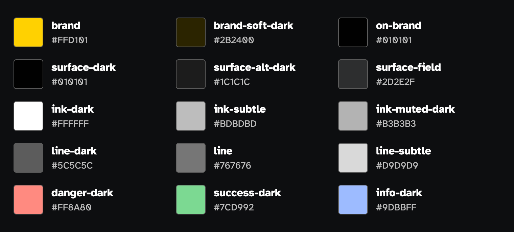

Defined in [`tailwind.config.js`](../../tailwind.config.js) and used as NativeWind classes
(`bg-brand`, `text-ink-subtle`, `border-line-dark`). The app uses the dark values.

| Token | Dark | Light | Use |
| :-- | :-- | :-- | :-- |
| `brand` | `#FFD101` | `#FFD101` | Primary fills, selection borders, active tab |
| `brand-soft` | `#2B2400` | `#FFF6CC` | Outline-button fill, answered RSVP bar |
| `on-brand` | `#010101` | — | Text and icons on `brand` |
| `surface` | `#010101` | `#FFFFFF` | Screen background |
| `surface-alt` | `#1C1C1C` | `#F2F2F2` | Header bands |
| `surface-field` | `#2D2E2F` | — | Inputs, error banner |
| `surface-card` | `#2E2E2E` | — | Date tile, RSVP options, coach note |
| `surface-raised` | `#1F1F1F` | — | Team info card |
| `surface-well` | `#262626` | — | Verify-email address box |
| `ink` | `#FFFFFF` | `#010101` | Primary text |
| `ink-muted` | `#B3B3B3` | `#4A4A4A` | Secondary labels |
| `ink-soft` | `#D9D9D9` | — | Secondary text (team, invite, verify-email) |
| `ink-quiet` | `#C9C9C9` | — | Secondary text (events) |
| `ink-subtle` | `#BDBDBD` | — | Helper text, captions |
| `line` / `line-dark` / `line-subtle` | `#767676` / `#5C5C5C` / `#D9D9D9` | — | Borders and dividers |
| `line-faint` / `line-muted` | `#2B2B2B` / `#3D3D3D` | — | Chat dividers / dropdown option rules |
| `line-track` / `line-strong` / `line-switch-off` | `#6B6B6B` / `#8C8C8C` / `#C6CACE` | — | Unfinished step / dashed photo outline, sheet handle / switch track when off |
| `ink-icon` | `#CFCFCF` | — | Empty profile-photo icon |
| `danger-soft` | `#2A1210` | — | `AlertBanner` background |
| `danger` | `#FF8A80` | `#B3261E` | Errors |
| `success` | `#7CD992` | `#1B6E35` | Success feedback |
| `info` | `#9DBBFF` | `#0B57D0` | Informational accents |

Tokens with both values use a `-dark` suffix for the dark one (`surface-dark`, `ink-dark`, …).
SVGs can't use Tailwind classes. `SuccessBadge`, `TabBarIcon`, and the older icons in
`src/assets/icons/` hard-code their colors; update them if a token changes. Icons added with the
2026-11-23 components use `currentColor`, so pass `color` (`<HashIcon color={colors.black} />`);
the hex values live in [`ui/tokens.ts`](ui/tokens.ts), with `PLACEHOLDER_COLOR` for text fields.

<a id="apptext"></a>

### Typography: `AppText`

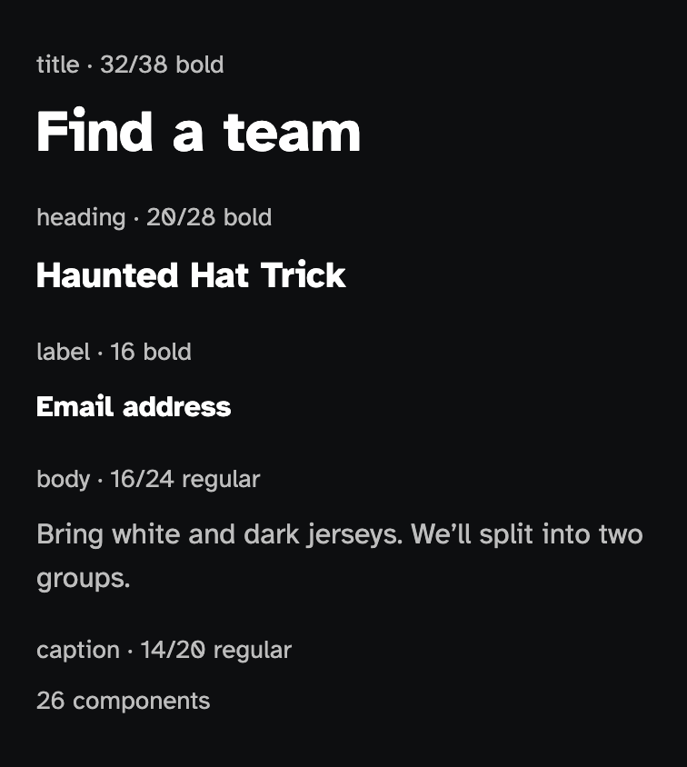

`Text` with one of the Figma type styles. The same sizes are available as Tailwind classes
(`text-h3`, `text-body`, …), each setting size and line height. Nothing goes below 16.5 px.

| Variant | Class | Size / line height | Weight | Color |
| :-- | :-- | :-- | :-- | :-- |
| `display` | `text-display` | 40 / 48 | Bold | `white` |
| `h1` | `text-h1` | 32 / 40 | Bold | `white` |
| `h2` | `text-h2` | 26 / 34 | Bold | `white` |
| `h3` | `text-h3` | 21 / 30 | Bold | `white` |
| `bodyLarge` | `text-body-lg` | 18 / 28 | Regular | `ink-subtle` |
| `body` (default) | `text-body` | 18 / 26 | Regular | `ink-subtle` |
| `label` | `text-label` | 18 / 24 | Bold | `white` |
| `caption` | `text-caption` | 18 / 24 | Regular | `ink-subtle` |
| `small` | `text-small` | 16.5 / 24 | Regular | `ink-subtle` |

Props: all `Text` props, plus `variant` (default `"body"`) and `className` (added after the
variant classes). `AppText` adds no role, so headings still need `accessibilityRole="header"`.

```tsx
<AppText variant="h1" accessibilityRole="header">Components</AppText>
<AppText variant="caption">26 components</AppText>
```

**Source:** [`ui/AppText.tsx`](ui/AppText.tsx)

## Actions

### AuthButton

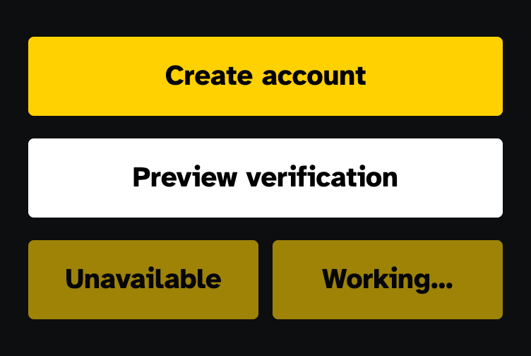 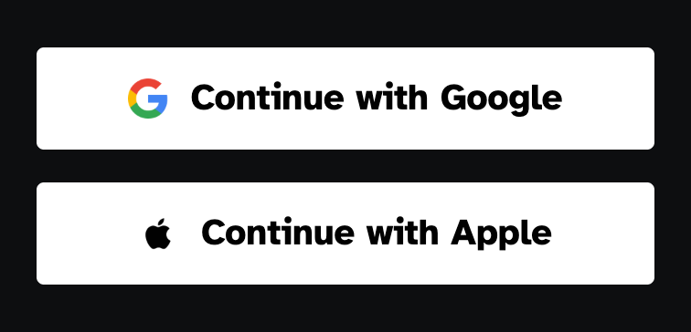

Full-width button for sign-up and log-in, at least 56 px tall.

| Prop | Type | Default | Description |
| :-- | :-- | :-- | :-- |
| `label` | `string` | required | Button text. |
| `onPress` | `() => void` | — | |
| `variant` | `"primary" \| "secondary"` | `"primary"` | Yellow or white fill. |
| `icon` | `ImageSourcePropType` | — | 22 px image before the label. |
| `disabled` | `boolean` | `false` | |
| `loading` | `boolean` | `false` | Disables the button and marks it busy. |
| `loadingLabel` | `string` | — | Replaces `label` while loading. |

```tsx
<AuthButton label="Create account" loadingLabel="Creating account…" loading={pending} onPress={create} />
<AuthButton variant="secondary" label="Continue with Google" icon={require("@/assets/icons/google.png")} onPress={google} />
```

**Source:** [`auth/AuthButton.tsx`](auth/AuthButton.tsx)

### AppButton

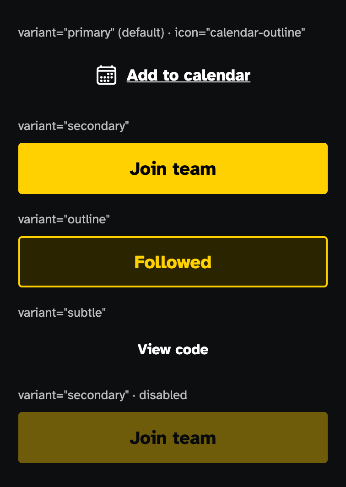

General-purpose button outside the auth flow.

| Variant | Look | Use |
| :-- | :-- | :-- |
| `primary` (default) | Underlined white text | Inline actions ("Create") |
| `secondary` | Yellow fill | Main call to action ("Join team") |
| `outline` | Yellow border | Secondary actions ("Roster") |
| `subtle` | Plain white text, 48 px tall | Toolbar actions |

| Prop | Type | Default | Description |
| :-- | :-- | :-- | :-- |
| `title` | `string` | required | Button text and default label. |
| `onPress` | `() => void` | required | |
| `variant` | see above | `"primary"` | |
| `icon` | Ionicons name | — | 24 px icon before the title. |
| `svgIcon` | SVG component | — | An icon from `@/assets/icons` instead of `icon`, to match Figma. |
| `size` | `"default" \| "compact"` | `"default"` | `compact`: 52 px, 8 px corners, 18 px text (chat buttons). |
| `disabled` | `boolean` | `false` | `secondary` turns into Figma's grey outline; other variants dim. |
| `ref` | `Ref<ViewInstance>` | — | For moving focus to the button. |
| `accessibilityState` | `AccessibilityState` | — | `selected` and `expanded` map to `aria-pressed` and `aria-expanded` on web. |
| `className` | `string` | `""` | Added after the variant classes. |

`accessibilityLabel` and `accessibilityHint` still work but are deprecated. Use
`screenReaderLabel` and `screenReaderHint`.

```tsx
<AppButton title="Create" onPress={onCreate} />
<AppButton title="Join team" variant="secondary" onPress={join} />
<AppButton title="Roster" icon="list" variant="outline" onPress={openRoster} />
```

**Source:** [`team/AppButton.tsx`](team/AppButton.tsx)

### AuthLinkButton

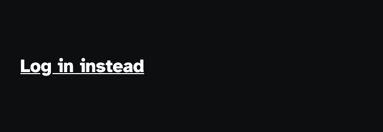

Underlined text action with a 48 px touch target. Props: `label` and `onPress` (both required),
`weight` (`"bold"` default, or `"regular"` for "Forgot password?"), and `align` (`"start"`
default, or `"center"` for "Back to Log in" at the bottom of a screen).

```tsx
<AuthLinkButton label="Log in" onPress={goToLogin} />
```

**Source:** [`auth/AuthLinkButton.tsx`](auth/AuthLinkButton.tsx)

### IconButton

An icon in a 48 px touch target: header actions (back, close, gear, info). `outlined` is the
52 px bordered box used for the chat composer's "+" button. Icon-only, so `label` is required.

| Prop | Type | Default | Description |
| :-- | :-- | :-- | :-- |
| `icon` | SVG component | required | From `@/assets/icons`. |
| `label` | `string` | required | Spoken name. |
| `onPress` | `() => void` | required | |
| `iconSize` | `number` | `24` | Chat gear and info use 26. |
| `color` | `string` | white | |
| `variant` | `"plain" \| "outlined"` | `"plain"` | |
| `badge` | `ReactNode` | — | Drawn on the icon's top-right corner. |

```tsx
<IconButton icon={GearIcon} iconSize={26} label="Notification settings" onPress={openSettings} />
```

**Source:** [`ui/IconButton.tsx`](ui/IconButton.tsx)

### FilterChip

Small outlined button above a list: Filter and Sort (6300), Unread and Read (6700). Solid yellow
when `selected`. A hit slop brings the 35 px chip to a 48 px target.

| Prop | Type | Default | Description |
| :-- | :-- | :-- | :-- |
| `label` | `string` | required | |
| `onPress` | `() => void` | required | |
| `selected` | `boolean` | `false` | |
| `icon` | SVG component | — | After the label (`filter.svg`, `expand-more.svg`). |

```tsx
<FilterChip label="Filter" icon={FilterIcon} onPress={openFilters} />
<FilterChip label="Unread" selected={tab === "unread"} onPress={() => setTab("unread")} />
```

**Source:** [`ui/FilterChip.tsx`](ui/FilterChip.tsx)

### Chip

A picked item with an X, such as a message recipient (7210). `tone="error"` is the red version
for a recipient that can't be messaged (7211). The X is spoken "Remove {label}"; the
screen-reader props apply to it.

| Prop | Type | Default | Description |
| :-- | :-- | :-- | :-- |
| `label` | `string` | required | |
| `onRemove` | `() => void` | — | Shows the X. |
| `tone` | `"default" \| "error"` | `"default"` | |

```tsx
<Chip label="Jordan P. · Player" onRemove={() => remove("jordan")} />
```

**Source:** [`ui/Chip.tsx`](ui/Chip.tsx)

### ChoiceButton

Square option in a row of choices (7311: 8 hours, 1 week, Until I turn it on). A radio button;
yellow outline when selected.

| Prop | Type | Default | Description |
| :-- | :-- | :-- | :-- |
| `label` | `string` | required | |
| `selected` | `boolean` | required | |
| `onPress` | `() => void` | required | |

```tsx
<View className="flex-row gap-2">
  {MUTE_OPTIONS.map((o) => <ChoiceButton key={o.value} label={o.label} selected={mute === o.value} onPress={() => setMute(o.value)} />)}
</View>
```

**Source:** [`ui/ChoiceButton.tsx`](ui/ChoiceButton.tsx)

## Inputs

### AuthTextField

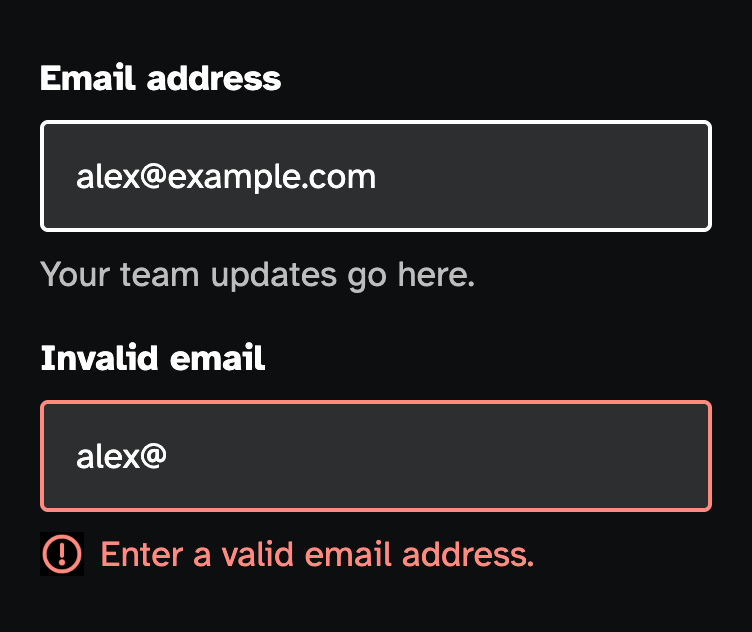 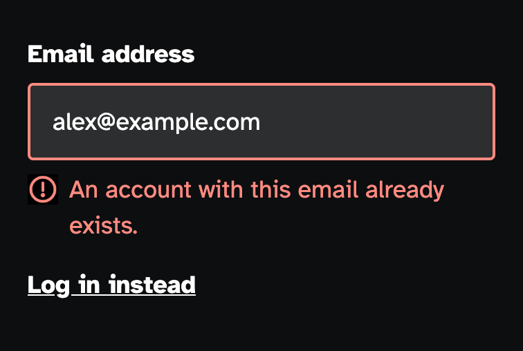

Labeled text input. The label is the input's spoken name, and the error is read as its hint.
Renders in order: label, input, error, `children`, helper text.

| Prop | Type | Default | Description |
| :-- | :-- | :-- | :-- |
| `label` | `string` | required | |
| `error` | `string \| null` | — | Red border and an `AuthErrorMessage`. |
| `helperText` | `string` | — | Shown under the field. |
| `accessory` | `ReactNode` | — | Shown inside the input on the right. |
| `children` | `ReactNode` | — | Shown under the error. |
| `ref` | `Ref<TextInputInstance>` | — | |
| `readOnly` | `boolean` | `false` | Also set by `editable={false}`. Darker box with a thin grey border (2400 Email, 8140 Current Email). |
| `multiline` | `boolean` | `false` | 140 px tall, text at the top (6500 Note for players). |
| `...TextInputProps` | | | Passed to the `TextInput`. Placeholders are `#BDBDBD`. |

```tsx
<AuthTextField label="Email address" value={email} onChangeText={setEmail} error={emailError}>
  {emailExists ? <AuthLinkButton label="Log in instead" onPress={goToLogin} /> : null}
</AuthTextField>
```

**Source:** [`auth/AuthTextField.tsx`](auth/AuthTextField.tsx)

### PasswordField

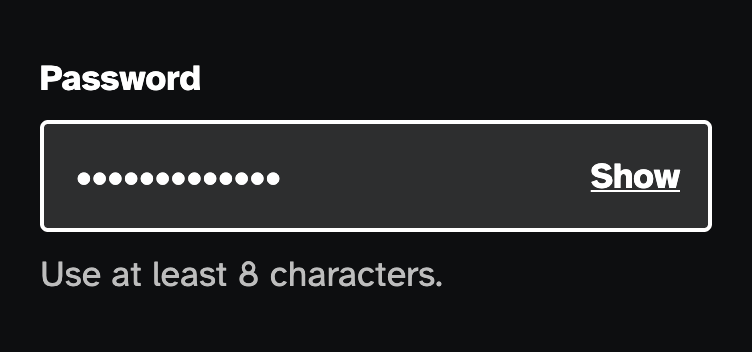 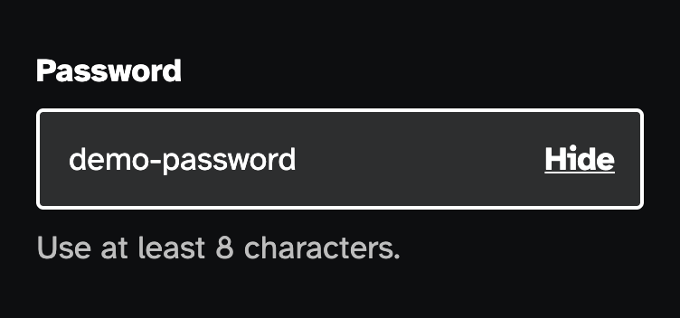

`AuthTextField` that masks its value, turns off autocapitalize and autocorrect, and adds a
Show/Hide button. The button appears only when there's a value, so pass `value`. Props: `label`
(required), `value`, `error`, `helperText`, `ref`, and any `TextInputProps`.

```tsx
<PasswordField label="Password" value={password} onChangeText={setPassword} error={passwordError} />
```

**Source:** [`auth/PasswordField.tsx`](auth/PasswordField.tsx)

### SearchField

Text field with a magnifying glass. `filled` is the borderless Home search (6100); `outlined`
has the white border (6530 location search, 7210 Search by name). Takes `TextInput` props.

| Prop | Type | Default | Description |
| :-- | :-- | :-- | :-- |
| `variant` | `"filled" \| "outlined"` | `"outlined"` | |
| `label` | `string` | the placeholder | Spoken name. |
| `hint` | `string` | — | |
| …`TextInputProps` | | | `value`, `onChangeText`, `placeholder`, … |

```tsx
<SearchField variant="filled" placeholder="Search team, event, or city" value={query} onChangeText={setQuery} />
```

**Source:** [`ui/SearchField.tsx`](ui/SearchField.tsx)

### SelectField

Labeled dropdown (2300 Gender, 4500 Age range and Location, 8120 Gender). Open, the field turns
black with a yellow outline and the options drop down below it, scrolling after five.

| Prop | Type | Default | Description |
| :-- | :-- | :-- | :-- |
| `label` | `string` | required | |
| `options` | `{ value, label }[]` | required | |
| `value` | `string` | — | |
| `onChange` | `(value) => void` | required | Picking an option also closes the list. |
| `placeholder` | `string` | `"Select"` | |

```tsx
<SelectField label="Gender" options={GENDERS} value={gender} onChange={setGender} />
```

**Source:** [`ui/SelectField.tsx`](ui/SelectField.tsx)

### PickerField

Labeled field that opens another screen to choose a value (6500 New Event: Date, Time, Location).
With `detail`, the value is bold and the detail sits under it (6501: rink over address).

| Prop | Type | Default | Description |
| :-- | :-- | :-- | :-- |
| `label` | `string` | required | |
| `onPress` | `() => void` | required | |
| `value` | `string` | — | |
| `detail` | `string` | — | Second line. |
| `placeholder` | `string` | `"Select"` | Grey until there's a value. |

```tsx
<PickerField label="Date" placeholder="Select date" value={dateLabel} onPress={() => router.push("/events/new/date")} />
```

**Source:** [`ui/PickerField.tsx`](ui/PickerField.tsx)

### ToggleCard

Bordered card with a title, a switch, and a description (2400 and 8170 "Allow location access").
The whole card is one switch for screen readers; the description is its hint.

| Prop | Type | Default | Description |
| :-- | :-- | :-- | :-- |
| `title` | `string` | required | |
| `description` | `string` | — | |
| `value` | `boolean` | required | |
| `onValueChange` | `(value: boolean) => void` | required | |

```tsx
<ToggleCard title="Allow location access" description="We'll use your location to show you teams and events near you." value={on} onValueChange={setOn} />
```

`Switch` (the 51 × 31 track) and `SelectionIndicator` (the 28 px check circle) are visual-only
pieces used inside `ToggleCard`, `ListRow`, and `RadioCard`. They have no screen-reader props.

**Source:** [`ui/ToggleCard.tsx`](ui/ToggleCard.tsx), [`ui/Switch.tsx`](ui/Switch.tsx)

### RangeSlider

Two-thumb range with typed values (4510 Age range). The value boxes are number fields and the
thumbs are adjustable, so screen-reader users can swipe up and down instead of dragging.

| Prop | Type | Default | Description |
| :-- | :-- | :-- | :-- |
| `label` | `string` | required | Visible legend. |
| `min` / `max` | `number` | required | |
| `low` / `high` | `number` | required | Controlled. |
| `onChange` | `(low, high) => void` | required | |
| `valueName` | `string` | `label` | Spoken as "Minimum {valueName}". |

```tsx
<RangeSlider label="Age range" valueName="age" min={0} max={99} low={low} high={high} onChange={(l, h) => { setLow(l); setHigh(h); }} />
```

**Source:** [`ui/RangeSlider.tsx`](ui/RangeSlider.tsx)

### Calendar

Month grid (6510). Days before `minDate` (default today) are crossed out and disabled, today has
a white ring, and the chosen day is yellow. Each day is read as "Saturday, November 21".

| Prop | Type | Default | Description |
| :-- | :-- | :-- | :-- |
| `month` | `Date` | required | Any day in the month to show. |
| `onMonthChange` | `(month: Date) => void` | required | |
| `selected` | `Date` | — | |
| `onSelect` | `(date: Date) => void` | required | |
| `minDate` | `Date \| null` | today | `null` allows any day. |
| `today` | `Date` | now | |

```tsx
<Calendar month={month} onMonthChange={setMonth} selected={date} onSelect={setDate} />
```

**Source:** [`ui/Calendar.tsx`](ui/Calendar.tsx)

### PhotoButton

88 px profile photo button. Empty (2200): dashed circle and a "+" badge. With a photo (8100): white
ring and a pencil badge. Usually opens an [`ActionSheet`](#actionsheet).

| Prop | Type | Default | Description |
| :-- | :-- | :-- | :-- |
| `source` | `ImageSourcePropType` | — | |
| `onPress` | `() => void` | required | |
| `caption` | `string` | — | Under the circle ("Add photo (optional)"). |

```tsx
<PhotoButton source={photo} caption="Add photo (optional)" onPress={() => setSheetOpen(true)} />
```

**Source:** [`ui/PhotoButton.tsx`](ui/PhotoButton.tsx)

### MessageComposer

Bottom bar of a conversation (7220, 7300): "+" attach button and the message field.

| Prop | Type | Default | Description |
| :-- | :-- | :-- | :-- |
| `value` / `onChangeText` | | required | Controlled. |
| `onSend` | `() => void` | required | Keyboard Send key. |
| `onAttach` | `() => void` | — | Shows the "+" button. |
| `placeholder` | `string` | required | "Message Jordan P." |

```tsx
<MessageComposer value={draft} onChangeText={setDraft} onSend={send} onAttach={attach} placeholder="Message #team" />
```

**Source:** [`ui/MessageComposer.tsx`](ui/MessageComposer.tsx)

## Navigation

### AuthHeader

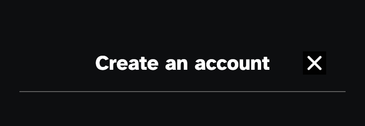

Centered title with a Close button. Props: `title` and `onClose` (both required).

```tsx
<AuthHeader title="Create an account" onClose={() => router.back()} />
```

**Source:** [`auth/AuthHeader.tsx`](auth/AuthHeader.tsx)

### TeamHeader

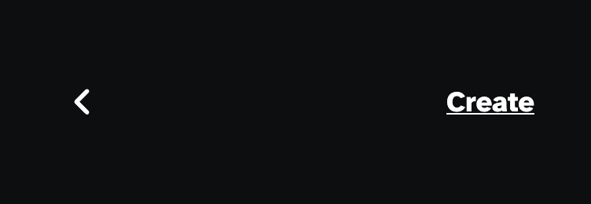

Back and Create bar for team screens. On `/tabs/teams/find` it also shows the title "Find a team"
(it reads the route itself). Props: `onBack` and `onCreate` (both required).

```tsx
<TeamHeader onBack={() => router.back()} onCreate={() => router.push("/tabs/teams/create")} />
```

**Source:** [`team/TeamHeader.tsx`](team/TeamHeader.tsx)

### TabBarButton, TabBarIcon, TabBarLabel

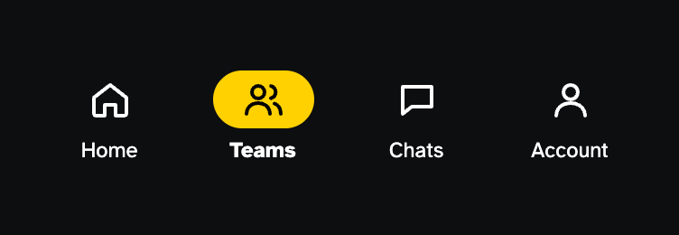

Bottom-tab item. The active tab has a yellow pill behind the icon and a bold label.
`type TabName = "home" | "teams" | "chats" | "account"`.

| Component | Props | Notes |
| :-- | :-- | :-- |
| `TabBarButton` | `name: TabName`, `focused`, `onPress` | Icon and label in one tab button. |
| `TabBarIcon` | `name: TabName`, `focused` | Hidden from screen readers by default. |
| `TabBarLabel` | `title`, `focused` | |

```tsx
// expo-router <Tabs> options
tabBarIcon: ({ focused }) => <TabBarIcon name={name} focused={focused} />,
tabBarLabel: ({ focused }) => <TabBarLabel title={title} focused={focused} />,
```

**Source:** [`teams/TabBarButton.tsx`](teams/TabBarButton.tsx), [`teams/TabBarIcon.tsx`](teams/TabBarIcon.tsx), [`teams/TabBarLabel.tsx`](teams/TabBarLabel.tsx)

### ScreenHeader

Top bar for any screen: an optional action on each side and a title. Use it for new screens;
`AuthHeader` and `TeamHeader` stay for the screens that already use them.

| Figma header | Props |
| :-- | :-- |
| Create team, New Event, Date, Forgot password (back + centered title) | `leading={{ kind: "back", onPress }}` |
| Sign up / Your info (back, title, close) | `leading={{ kind: "back" }}` `trailing={{ kind: "close" }}` |
| Account edits ("Cancel" + 26 px title, no rule) | `leading={{ kind: "text", text: "Cancel", weight: "regular" }}` `titleSize="large"` `divider="none"` |
| New message ("< Cancel") | `leading={{ kind: "text", text: "Cancel", withBackIcon: true }}` `divider="subtle"` |
| Channel info (back + start-aligned title) | `titleAlign="start"` `divider="subtle"` |
| Channel notifications (title + close) | `titleAlign="start"` `trailing={{ kind: "close" }}` |
| Coach event details ("Edit") | `trailing={{ kind: "text", text: "Edit" }}` |

| Prop | Type | Default | Description |
| :-- | :-- | :-- | :-- |
| `title` | `string` | — | |
| `titleSize` | `"default" \| "large"` | `"default"` | 21/30 or 26/34. |
| `titleAlign` | `"center" \| "start"` | `"center"` | |
| `leading` / `trailing` | `ScreenHeaderAction` | — | `{ kind: "back" \| "close" \| "text" \| "icon", onPress, … }` plus optional `label`, `hint`, `pressAnnouncement`. |
| `divider` | `"default" \| "subtle" \| "none"` | `"default"` | `#5C5C5C`, `#2B2B2B`, or none. |
| `children` | `ReactNode` | — | Replaces the title. |

```tsx
<ScreenHeader title="New Event" leading={{ kind: "back", onPress: router.back }} />
<ScreenHeader title="Change name" titleSize="large" divider="none" leading={{ kind: "text", text: "Cancel", weight: "regular", onPress: router.back }} />
```

**Source:** [`ui/ScreenHeader.tsx`](ui/ScreenHeader.tsx)

### SegmentedControl

Mutually exclusive options; the chosen one is solid yellow. `default` is the full-width Home
switch (For You / Discover); `compact` is the AM / PM toggle (6520). Each option is a radio button.

| Prop | Type | Default | Description |
| :-- | :-- | :-- | :-- |
| `options` | `{ value, label }[]` | required | |
| `value` | `string` | required | |
| `onChange` | `(value) => void` | required | |
| `label` | `string` | required | Spoken group name. |
| `size` | `"default" \| "compact"` | `"default"` | |
| `screenReaderParts` | `{ [value]: { label, hint, pressAnnouncement } }` | — | |

```tsx
<SegmentedControl label="Home feed" value={feed} onChange={setFeed} options={[{ value: "forYou", label: "For You" }, { value: "discover", label: "Discover" }]} />
```

**Source:** [`ui/SegmentedControl.tsx`](ui/SegmentedControl.tsx)

### TabStrip

Underlined tabs across a screen (7100 Channels / Messages), with an optional unread count.

| Prop | Type | Default | Description |
| :-- | :-- | :-- | :-- |
| `tabs` | `{ value, label, count? }[]` | required | |
| `value` | `string` | required | |
| `onChange` | `(value) => void` | required | |

```tsx
<TabStrip value={tab} onChange={setTab} tabs={[{ value: "channels", label: "Channels" }, { value: "messages", label: "Messages", count: 3 }]} />
```

**Source:** [`ui/TabStrip.tsx`](ui/TabStrip.tsx)

### StepProgress

Segmented progress bar for multi-step forms (2200–3500). Read as "Step 1 of 3".

| Prop | Type | Default | Description |
| :-- | :-- | :-- | :-- |
| `current` | `number` | required | 1-based. |
| `total` | `number` | required | |

```tsx
<StepProgress current={2} total={3} />
```

**Source:** [`ui/StepProgress.tsx`](ui/StepProgress.tsx)

## Teams

### TeamIcon

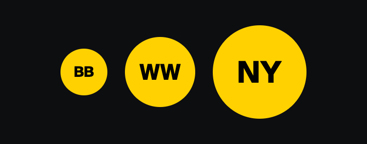

Team initials in a yellow circle, used in place of a logo. Hidden from screen readers by default.

| Prop | Type | Default | Description |
| :-- | :-- | :-- | :-- |
| `name` | `string` | required | Initials come from the first two words. |
| `size` | `number` | `140` | Diameter in px. |
| `textSize` | `number` | 34% of `size` | |

```tsx
<TeamIcon name="Baltimore Blades" size={48} textSize={18} />
```

**Source:** [`team/TeamIcon.tsx`](team/TeamIcon.tsx)

### TeamInfoCard

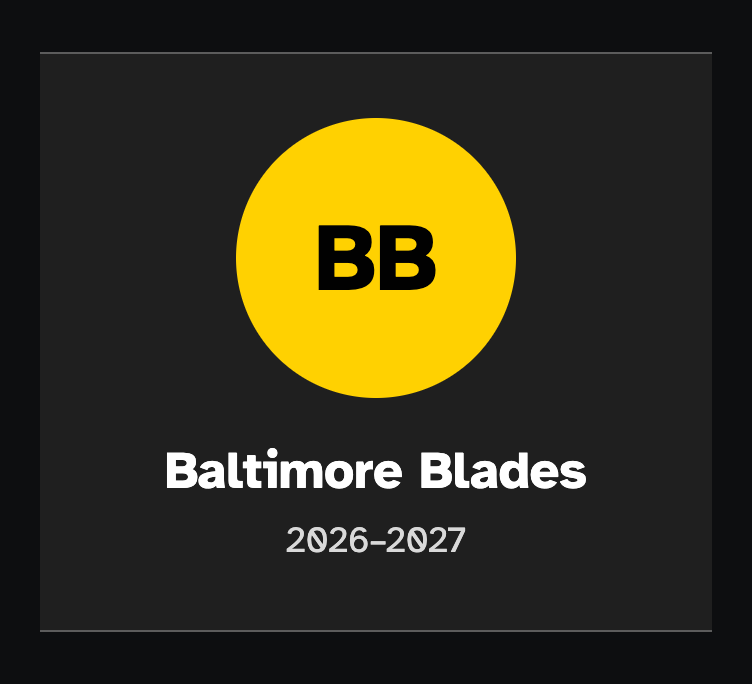

Team icon, name, and season for the top of a team page. `children` render below the season.

| Prop | Type | Default | Description |
| :-- | :-- | :-- | :-- |
| `name` | `string` | required | |
| `season` | `string` | required | For example `"2026–2027"`. Read as "2026–2027 season". |
| `children` | `ReactNode` | — | |

```tsx
<TeamInfoCard name={team.name} season={getSeasonLabel()}>
  <AppButton title="Roster" icon="list" variant="outline" onPress={viewRoster} />
</TeamInfoCard>
```

**Source:** [`team/TeamInfoCard.tsx`](team/TeamInfoCard.tsx)

### TeamListRow

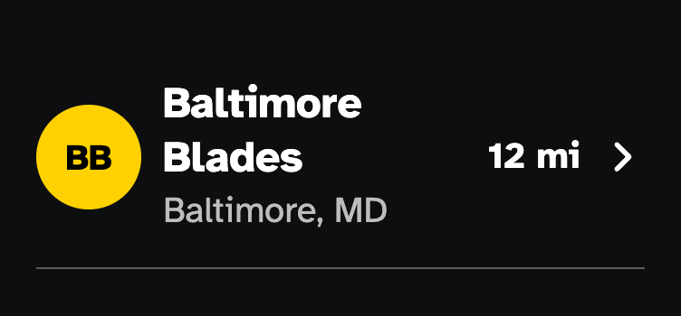

One Find a Team result. The whole row is one button, read as "Baltimore Blades, {city}, {state},
12 miles away".

| Prop | Type | Default | Description |
| :-- | :-- | :-- | :-- |
| `team` | `TeamWithId` | required | `region` is a 1-based index (as a string) into `regions` from `@/services/teamService`. |
| `distanceMiles` | `number` | required | |
| `onPress` | `() => void` | Opens the team page | |

```tsx
<TeamListRow team={team} distanceMiles={12} />
```

**Source:** [`team/TeamListRow.tsx`](team/TeamListRow.tsx)

### TeamCard

Team tile for the two-column grids (6200 Teams Nearby, 6600). Two stops: the summary, then
Follow / Followed.

| Prop | Type | Default | Description |
| :-- | :-- | :-- | :-- |
| `name` | `string` | required | |
| `ages` | `string` | required | "Ages 12 to 40", "All ages". |
| `city` | `string` | required | |
| `following` | `boolean` | required | |
| `onToggleFollow` | `() => void` | required | |

```tsx
<View className="flex-row gap-5">
  <TeamCard name="Team Name" ages="Ages 12 to 40" city="City" following={false} onToggleFollow={toggle} />
</View>
```

**Source:** [`team/TeamCard.tsx`](team/TeamCard.tsx)

## Events

These make up [`EventDetails`](#eventdetails) and also work on their own.

### EventHeader

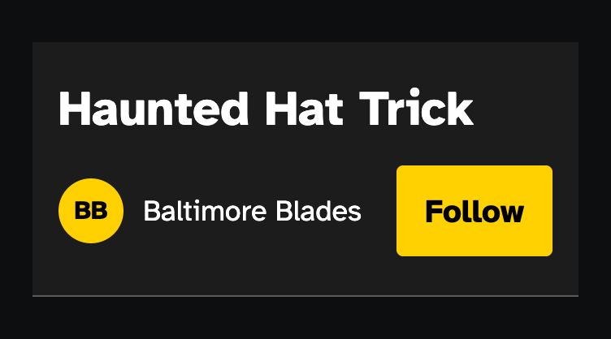

Event title, team name, and a [`TeamRelationship`](#teamrelationship).

| Prop | Type | Default | Description |
| :-- | :-- | :-- | :-- |
| `title` | `string` | required | |
| `teamName` | `string` | required | |
| `followed` | `boolean` | required | Controlled. |
| `onToggleFollow` | `() => void` | required | |
| `membership` | `"requested" \| "joined" \| "coach"` | — | Shows a status label instead of Follow. |

```tsx
<EventHeader title="Haunted Hat Trick" teamName="Baltimore Blades" followed={followed} onToggleFollow={toggle} />
```

**Source:** [`events/EventHeader.tsx`](events/EventHeader.tsx)

### TeamRelationship

The viewer's relationship to a team. `not-following` and `following` are a toggle button
(announces the new state when pressed). `requested`, `joined`, and `coach` are plain labels.

| Prop | Type | Default | Description |
| :-- | :-- | :-- | :-- |
| `state` | `"not-following" \| "following" \| "requested" \| "joined" \| "coach"` | required | |
| `teamName` | `string` | required | Used in the label ("Follow Baltimore Blades"). |
| `onToggleFollow` | `() => void` | — | |

```tsx
<TeamRelationship state={followed ? "following" : "not-following"} teamName="Baltimore Blades" onToggleFollow={toggle} />
<TeamRelationship state="joined" teamName="Baltimore Blades" />
```

**Source:** [`events/TeamRelationship.tsx`](events/TeamRelationship.tsx)

### EventDateTime

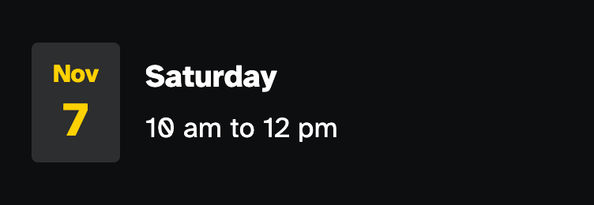

Date tile with weekday and time range, read as "Saturday, November 7, 10 AM to 12 PM". Props:
`start` and `end` (both required `Date`s).

```tsx
<EventDateTime start={event.startTime} end={event.endTime} />
```

**Source:** [`events/EventDateTime.tsx`](events/EventDateTime.tsx)

### EventLocation

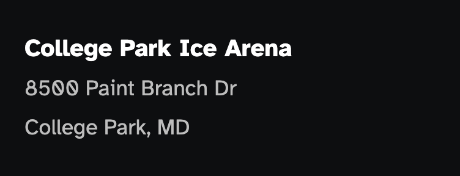

Splits `"Venue, Street, City, ST"` into a venue and address lines. The spoken version expands
abbreviations ("Dr" → "Drive", "MD" → "Maryland"). Props: `location` (required).

```tsx
<EventLocation location="College Park Ice Arena, 8500 Paint Branch Dr, College Park, MD" />
```

**Source:** [`events/EventLocation.tsx`](events/EventLocation.tsx)

### RsvpSection

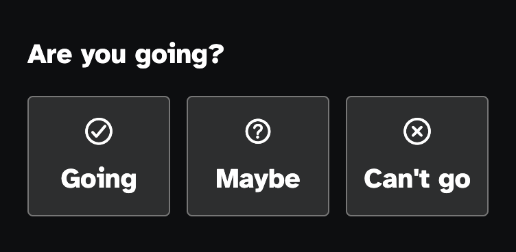 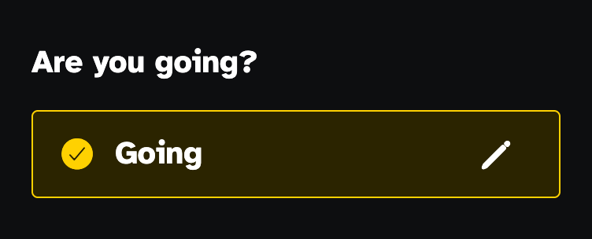 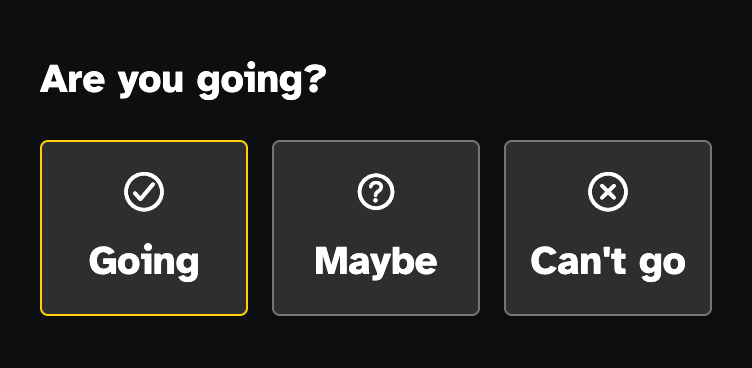

Going, Maybe, or Can't go. Choosing one collapses to a "Your reply" bar with an edit button.
Options are radio buttons on Android and selectable buttons on iOS and web. On native, focus moves
to the reply after answering and back to the heading after pressing edit.
`type RsvpResponse = "going" | "maybe" | "cant-go"`.

| Prop | Type | Default | Description |
| :-- | :-- | :-- | :-- |
| `value` | `RsvpResponse \| null` | required | `null` shows the options. |
| `onChange` | `(value: RsvpResponse) => void` | required | |

```tsx
const [rsvp, setRsvp] = useState<RsvpResponse | null>(null);
<RsvpSection value={rsvp} onChange={setRsvp} />
```

**Source:** [`events/RsvpSection.tsx`](events/RsvpSection.tsx)

### EventNote

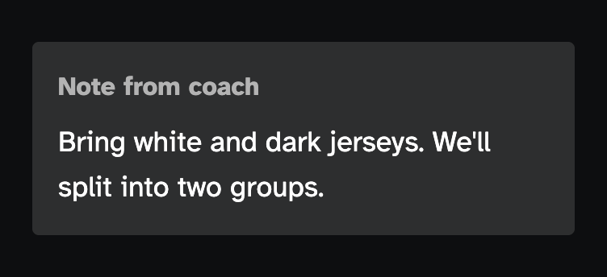

Note from the coach. Renders nothing when `notes` is empty. Props: `notes`, `label` (default
"Note from coach"; the coach's own view uses "Note for players"), and `onEdit` (shows an "Edit"
link, spoken "Edit note for players").

```tsx
<EventNote notes={event.notes} />
<EventNote notes={event.notes} label="Note for players" onEdit={editNote} />
```

**Source:** [`events/EventNote.tsx`](events/EventNote.tsx)

### EventCard

Event summary for lists (6100 Schedule, 6200, 6300, 6900). One button read as the title, the
full date and time, the place, the team, and the status.

| Prop | Type | Default | Description |
| :-- | :-- | :-- | :-- |
| `title` | `string` | required | |
| `start` / `end` | `Date` | required | |
| `location` | `string` | required | "Venue, Street, City, ST"; the card shows venue and city. |
| `teamName` | `string` | required | Shown as an initials [`Tag`](#tag). |
| `status` | `string` | — | "Joined", "Followed". |
| `onPress` | `() => void` | required | |

```tsx
<EventCard title={event.title} start={event.startTime} end={event.endTime} location={event.location} teamName={team.name} status="Joined" onPress={open} />
```

**Source:** [`events/EventCard.tsx`](events/EventCard.tsx)

### DateTile

The 56 × 92 month-and-day tile. `card` is grey (event details); `black` sits inside a grey
card (`EventCard`). Decorative by default.

```tsx
<DateTile month="Nov" day="21" tone="black" />
```

**Source:** [`ui/DateTile.tsx`](ui/DateTile.tsx)

### RsvpReplies

Who replied, grouped by answer (6450 coach event details, 6452 Replies). Empty groups are skipped.

| Prop | Type | Default | Description |
| :-- | :-- | :-- | :-- |
| `groups` | `{ label, names }[]` | required | Heading reads "{names.length} {label}". |
| `heading` | `string` | — | "Replies" on event details. |
| `limit` | `number` | all | Names per group. |
| `onSeeAll` | `() => void` | — | Shows "See all replies". |

```tsx
<RsvpReplies heading="Replies" limit={3} onSeeAll={openReplies} groups={[{ label: "going", names: going }, { label: "maybe", names: maybe }, { label: "can't go", names: cantGo }]} />
```

**Source:** [`events/RsvpReplies.tsx`](events/RsvpReplies.tsx)

For the coach's view (6450), [`EventNote`](#eventnote) takes `label="Note for players"` and
`onEdit`, and the header is a [`ScreenHeader`](#screenheader) with an "Edit" text action.

## Invitations

The invite screen ([`app/invite/index.tsx`](../app/invite/index.tsx)), top to bottom.

### TeamBadge

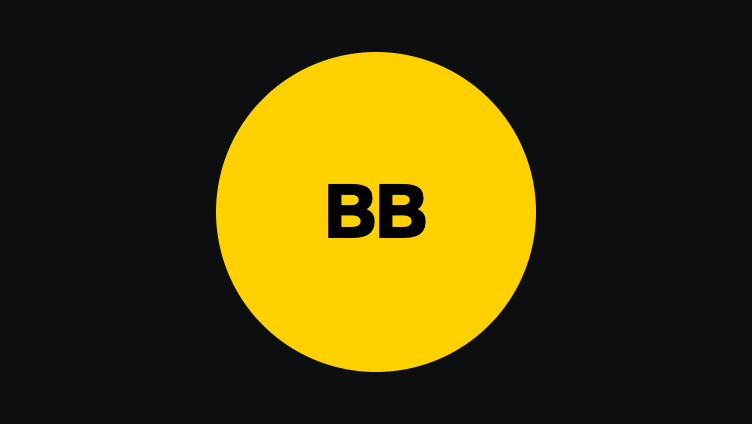

Large team logo, read as "{teamName} logo". Props: `teamName` (required).

**Source:** [`invite/TeamBadge.tsx`](invite/TeamBadge.tsx)

### InviteMessage

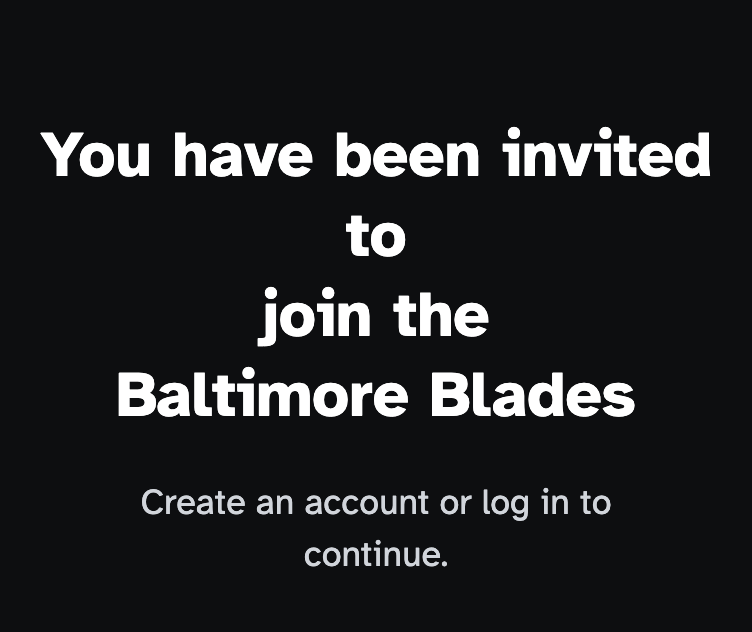

"You have been invited to join the {team}" and what to do next. Props: `teamName` (required).

**Source:** [`invite/InviteMessage.tsx`](invite/InviteMessage.tsx)

### InviteActions

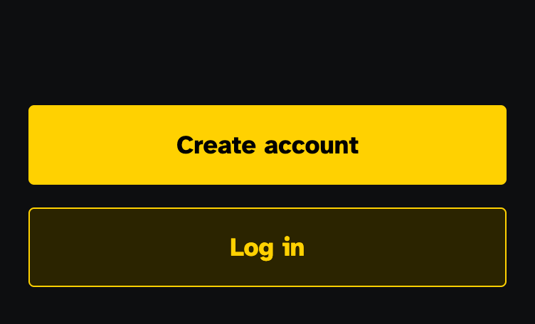

Create account and Log in buttons. Includes its own top margin. Props: `onCreateAccount` and
`onLogIn` (both required).

```tsx
<InviteActions onCreateAccount={goToSignup} onLogIn={goToLogin} />
```

**Source:** [`invite/InviteActions.tsx`](invite/InviteActions.tsx)

## Feedback

### AuthErrorMessage

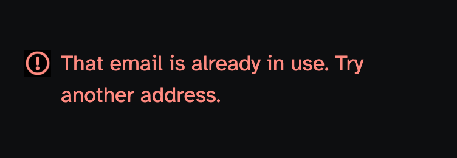

Icon and error text, announced when it appears (`accessibilityRole="alert"`). Used by
`AuthTextField`. For errors about the whole form, use `AuthErrorBanner`. Props: `message`
(required).

```tsx
{formError ? <AuthErrorMessage message={formError} /> : null}
```

**Source:** [`auth/AuthErrorMessage.tsx`](auth/AuthErrorMessage.tsx)

### AuthErrorBanner

Bordered error box above a form's fields, announced as one alert. Not used in a screen yet.

| Prop | Type | Description |
| :-- | :-- | :-- |
| `title` | `string` | What went wrong. |
| `message` | `string` | What to do next. |

```tsx
<AuthErrorBanner
  title="Email or password is incorrect."
  message="Check them and try again, or reset your password."
/>
```

**Source:** [`auth/AuthErrorBanner.tsx`](auth/AuthErrorBanner.tsx)

### SuccessBadge

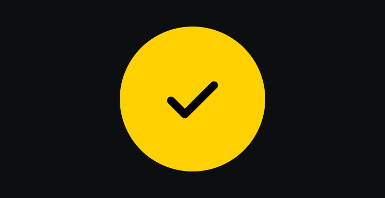

Yellow check mark for success screens. Hidden from screen readers by default, so put a heading
next to it. No other props.

**Source:** [`teams/SuccessBadge.tsx`](teams/SuccessBadge.tsx)

### RequestSentMessage

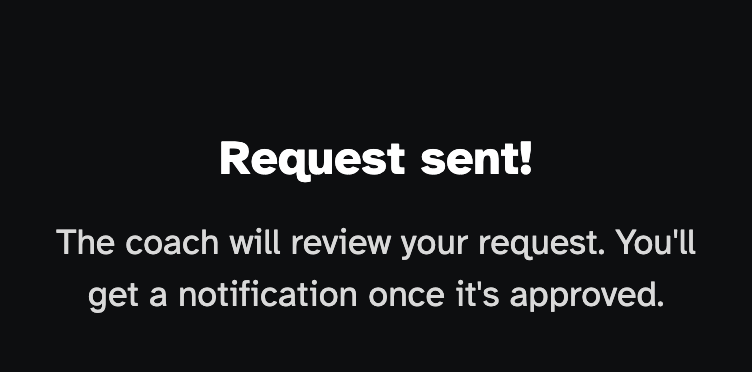

"Request sent!" heading and explanation after asking to join a team. The text is fixed.

**Source:** [`teams/RequestSentMessage.tsx`](teams/RequestSentMessage.tsx)

### OrDivider

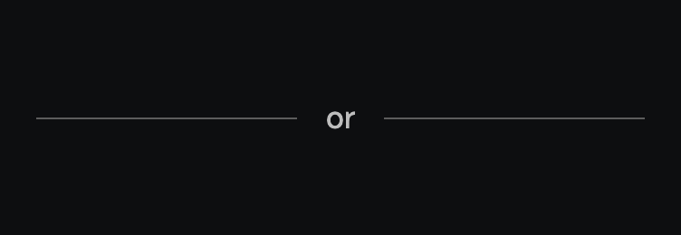

A rule with "or" in the middle. No props.

**Source:** [`auth/OrDivider.tsx`](auth/OrDivider.tsx)

### AlertBanner

Red banner for something that isn't allowed (7211 "Not allowed: player-to-player message"). For a
form error after submitting, use [`AuthErrorBanner`](#autherrorbanner).

| Prop | Type | Default | Description |
| :-- | :-- | :-- | :-- |
| `title` | `string` | required | |
| `message` | `string` | — | |

```tsx
<AlertBanner title="Not allowed: player-to-player message" message="Add a coach or staff member to start a group message." />
```

**Source:** [`ui/AlertBanner.tsx`](ui/AlertBanner.tsx)

### CenteredMessage

Centered title and message for confirmations and empty states: 5500 Password updated, 4600 Team
request sent!, 7130 You haven't joined a team yet.

| Prop | Type | Default | Description |
| :-- | :-- | :-- | :-- |
| `title` | `string` | required | |
| `message` | `string` | — | |
| `badge` | `ReactNode` | — | Above the title, e.g. `<SuccessBadge />`. |
| `children` | `ReactNode` | — | Under the message, e.g. a button. |

```tsx
<CenteredMessage badge={<SuccessBadge />} title="Password updated" message="You can now log in to Dented Puck with your new password." />
```

**Source:** [`ui/CenteredMessage.tsx`](ui/CenteredMessage.tsx)

### CountBadge

Yellow pill with an unread count (chat tabs, channels, conversations). Renders nothing at 0.

```tsx
<CountBadge count={3} />
```

**Source:** [`ui/CountBadge.tsx`](ui/CountBadge.tsx)

### Tag

Yellow text in a thin yellow outline: team initials on event cards, "Coach" next to a chat name
(`size="compact"`).

```tsx
<Tag label="BB" />
<Tag label="Coach" size="compact" />
```

**Source:** [`ui/Tag.tsx`](ui/Tag.tsx)

### Avatar

A photo, or initials on yellow (`brand`: coaches, staff, teams) or white (`light`: players).
`rounded` is the 8 px-corner team tile. Decorative by default because the name is next to it.

| Prop | Type | Default | Description |
| :-- | :-- | :-- | :-- |
| `name` | `string` | required | Initials and spoken label. |
| `source` | `ImageSourcePropType` | — | |
| `size` | `number` | `44` | |
| `shape` | `"circle" \| "rounded"` | `"circle"` | |
| `tone` | `"brand" \| "light"` | `"brand"` | |
| `ring` | `boolean` | `false` | White 2 px ring. |
| `initials` | `string` | from `name` | |

```tsx
<Avatar name="Jordan P." tone="light" size={52} />
```

**Source:** [`ui/Avatar.tsx`](ui/Avatar.tsx)

## Lists

### SectionHeader

Section heading with an optional link: `large` "Schedule" + "See all" (6100), `medium` "Recent"
(6530), `small` "Players · 15" (7310), `muted` "Coaches and staff" (7210).

| Prop | Type | Default | Description |
| :-- | :-- | :-- | :-- |
| `title` | `string` | required | |
| `size` | `"large" \| "medium" \| "small" \| "muted"` | `"large"` | |
| `action` | `{ label, onPress }` | — | Spoken "{label}, {title}". |

```tsx
<SectionHeader title="Schedule" action={{ label: "See all", onPress: openSchedule }} />
```

**Source:** [`ui/SectionHeader.tsx`](ui/SectionHeader.tsx)

### ListRow

One row in a list. With `onPress` it's a button, or a checkbox when `accessory` is `selected` /
`unselected`.

| Figma | Props |
| :-- | :-- |
| 8100 Account settings | `title="Name" value="Jordan Lee" valueTone="default" accessory="chevron" size="compact"` |
| 7310 members | `leading={<Avatar … size={40} />} title="Coach Riley" value="Coach" divider="subtle"` |
| 7210 people to message | `leading={<Avatar … />} title="Coach Riley" subtitle="Coach" accessory="selected" size="large" divider="subtle"` |
| 6530 location results | `title="College Park Ice Arena" subtitle="College Park, MD" divider="default"` |
| 6452 reply names | `title="Jordan P." titleWeight="regular" size="compact"` |

| Prop | Type | Default | Description |
| :-- | :-- | :-- | :-- |
| `title` | `string` | required | |
| `subtitle` | `string` | — | Grey second line. |
| `value` | `string` | — | Right-hand text. |
| `valueTone` | `"muted" \| "default"` | `"muted"` | |
| `leading` | `ReactNode` | — | |
| `icon` | SVG component | — | 24 px, left. |
| `accessory` | `"chevron" \| "selected" \| "unselected" \| ReactNode` | — | |
| `onPress` | `() => void` | — | |
| `divider` | `"none" \| "subtle" \| "default"` | `"none"` | |
| `titleWeight` | `"bold" \| "regular"` | `"bold"` | |
| `size` | `"compact" \| "default" \| "large"` | `"default"` | 48, 56, or 64 px. |

**Source:** [`ui/ListRow.tsx`](ui/ListRow.tsx)

### ListGroup

`ListRow`s in a rounded grey card with rules between them (7310 "Notify me about", "Mute this channel").

```tsx
<ListGroup rows={[
  { key: "notify", icon: BellIcon, title: "Notify me about", subtitle: "All messages", accessory: "chevron", onPress: openNotify },
  { key: "mute", icon: BellOffIcon, title: "Mute this channel", subtitle: "Off", accessory: "chevron", onPress: openMute },
]} />
```

**Source:** [`ui/ListGroup.tsx`](ui/ListGroup.tsx)

### RadioCard

One option with a title and description (7311: All messages, Only @mentions, Nothing). Put a
`SectionHeader size="small"` above the group.

| Prop | Type | Default | Description |
| :-- | :-- | :-- | :-- |
| `title` | `string` | required | |
| `description` | `string` | — | Also the spoken hint. |
| `selected` | `boolean` | required | |
| `onPress` | `() => void` | required | |

**Source:** [`ui/RadioCard.tsx`](ui/RadioCard.tsx)

## Home and notifications

### HomeHeader

Dented Puck wordmark and the notifications bell (6100). `hasUnread` adds the yellow ring and dot (6110).

```tsx
<HomeHeader hasUnread={unread > 0} onNotificationsPress={() => router.push("/notifications")} />
```

**Source:** [`home/HomeHeader.tsx`](home/HomeHeader.tsx)

### NotificationCard

One notification (6700, 6800): avatar, title, date, optional "Announcement sent to …" line, and
the message. Unread ones have a yellow outline and say "Unread" first.

| Prop | Type | Default | Description |
| :-- | :-- | :-- | :-- |
| `title` | `string` | required | Sender or subject. |
| `date` | `string` | required | "10/28". |
| `body` | `string` | required | |
| `avatarName` | `string` | required | Initials when there's no photo. |
| `avatarSource` | `ImageSourcePropType` | — | |
| `audience` | `string` | — | "Announcement sent to {audience}". |
| `unread` | `boolean` | `false` | |
| `onPress` | `() => void` | required | |

**Source:** [`notifications/NotificationCard.tsx`](notifications/NotificationCard.tsx)

### AnnouncementHeader

Title and sender at the top of a notification (6900).

```tsx
<AnnouncementHeader title="Practice moved to Nov 1" sender="Coach Seonasa" recipients="Baltimore Blades" sentAt="Oct 28 at 4:12 pm" senderPhoto={photo} />
```

**Source:** [`notifications/AnnouncementHeader.tsx`](notifications/AnnouncementHeader.tsx)

## Chat

| Component | Figma | Notes |
| :-- | :-- | :-- |
| [`ChatListHeader`](chat/ChatListHeader.tsx) | 7100–7130 | Team name (opens the switcher when `onTitlePress` is set) and the gear. |
| [`TeamSwitcherMenu`](chat/TeamSwitcherMenu.tsx) | 7110 | `teams`, `selectedId`, `onSelect`. Each team is a radio button. |
| [`ChannelCard`](chat/ChannelCard.tsx) | 7100 | `name`, `time`, `lastSender`, `lastMessage`, `unread`, `onPress`. |
| [`ConversationRow`](chat/ConversationRow.tsx) | 7200 | `name`, `avatarTone`, `time`, `lastMessage`, `unread`, `onPress`. Unread messages are bold. |
| [`ConversationHeader`](chat/ConversationHeader.tsx) | 7220, 7300 | `title`, `subtitle`, `kind` (`person` / `channel`), `onBack`, `onInfo`. |
| [`DateDivider`](chat/DateDivider.tsx) | 7220, 7300 | `label` ("Today"). |
| [`MessageBubble`](chat/MessageBubble.tsx) | 7220 | `text`, `time`, `direction` (`incoming` / `outgoing`), `sender`. |
| [`ChannelMessage`](chat/ChannelMessage.tsx) | 7300 | `sender`, `role` (yellow tag), `text`, `time`, `avatarTone`. |
| [`ChannelIdentity`](chat/ChannelIdentity.tsx) | 7310 | `name`, `detail`. |
| [`MessageComposer`](#messagecomposer) | 7220, 7300 | |

"New message", "Start conversation", and "Done" are `AppButton` with `size="compact"` (52 px, 8 px
corners, 18 px text). A disabled `secondary` `AppButton` is drawn as Figma's grey outline (7211).

```tsx
<AppButton title="New message" variant="secondary" size="compact" svgIcon={NewMessageIcon} onPress={compose} />
```

## Overlays

### ActionSheet

Bottom sheet with actions and Cancel (2210 Profile photo). Opens as a modal, so screen readers
stay inside it until it closes.

| Prop | Type | Default | Description |
| :-- | :-- | :-- | :-- |
| `visible` | `boolean` | required | |
| `title` | `string` | required | |
| `actions` | `{ key, label, icon?, onPress, screenReader? }[]` | required | |
| `onClose` | `() => void` | required | Cancel, backdrop tap, Android back. |
| `cancelLabel` | `string` | `"Cancel"` | |

```tsx
<ActionSheet visible={open} title="Profile photo" onClose={() => setOpen(false)} actions={[
  { key: "take", label: "Take photo", icon: CameraIcon, onPress: takePhoto },
  { key: "pick", label: "Choose from library", icon: ImageIcon, onPress: pickPhoto },
]} />
```

**Source:** [`ui/ActionSheet.tsx`](ui/ActionSheet.tsx)

## Layout and accessibility

### SlidingPages

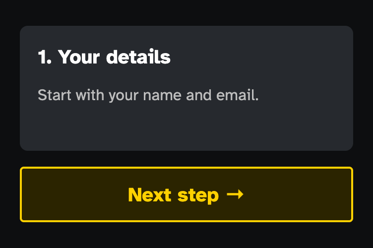 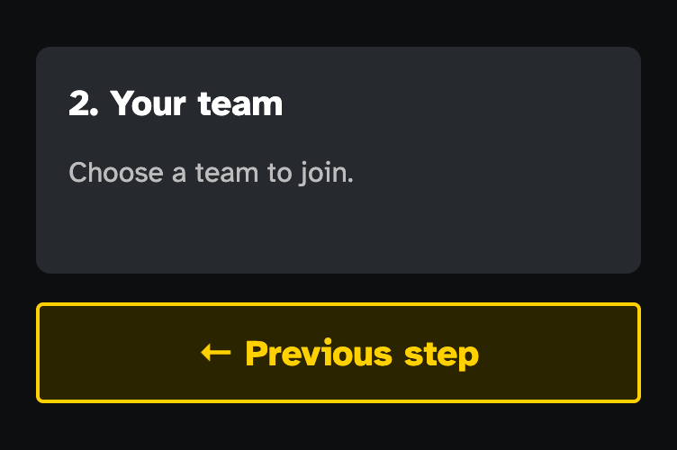

Horizontal pager for multi-step flows. Slides when `activeIndex` changes, or switches instantly with
`reduceMotion`. Only the active page is visible to screen readers and touch.

| Prop | Type | Description |
| :-- | :-- | :-- |
| `activeIndex` | `number` | Required. |
| `reduceMotion` | `boolean` | Required. Pass `useReducedMotion()`. |
| `children` | `ReactNode[]` | Required. One keyed element per page. |

The parent must give `SlidingPages` a height (`flex: 1` or fixed), because pages are absolutely
positioned.

```tsx
<View style={{ flex: 1 }}>
  <SlidingPages activeIndex={step} reduceMotion={useReducedMotion()}>
    {[<DetailsStep key="details" />, <TeamStep key="team" />]}
  </SlidingPages>
</View>
```

**Source:** [`auth/SlidingPages.tsx`](auth/SlidingPages.tsx)

### AccessibilityOrder

Sets the native screen-reader order from a list of descendant `nativeID`s. List every stop, since
unlisted elements are skipped. Accepts `ViewProps`. Has no effect on the web.

```tsx
<AccessibilityOrder order={["title", ...(error ? ["error"] : []), "save"]}>
  <Text nativeID="title" accessibilityRole="header">Your profile</Text>
  {error && <Text nativeID="error" accessible>{error}</Text>}
  <Pressable nativeID="save" accessibilityRole="button" onPress={onSave}>
    <Text>Save profile</Text>
  </Pressable>
</AccessibilityOrder>
```

Needs the `enableAccessibilityOrder` flag (see [Reading order](#reading-order)). Full guide:
[`docs/accessibility.md`](../../docs/accessibility.md).

**Source:** [`accessibility/AccessibilityOrder.tsx`](accessibility/AccessibilityOrder.tsx)

### ScreenReaderOrderScope

Builds an `AccessibilityOrder` from the `screenReaderOrder` numbers inside it. See
[Reading order](#reading-order). Accepts `ViewProps`, `screenReaderOrder` (its position in an
outer scope), and `hideFromScreenReader`.

```tsx
function Score({ order }: { order: number }) {
  const nativeID = useScreenReaderOrder(order);
  return <Text nativeID={nativeID}>Blades 3, Hawks 2</Text>;
}
```

**Source:** [`accessibility/ScreenReaderOrderScope.tsx`](accessibility/ScreenReaderOrderScope.tsx)

## Compositions

Screen bodies built from the components above.

### VerifyEmailContent

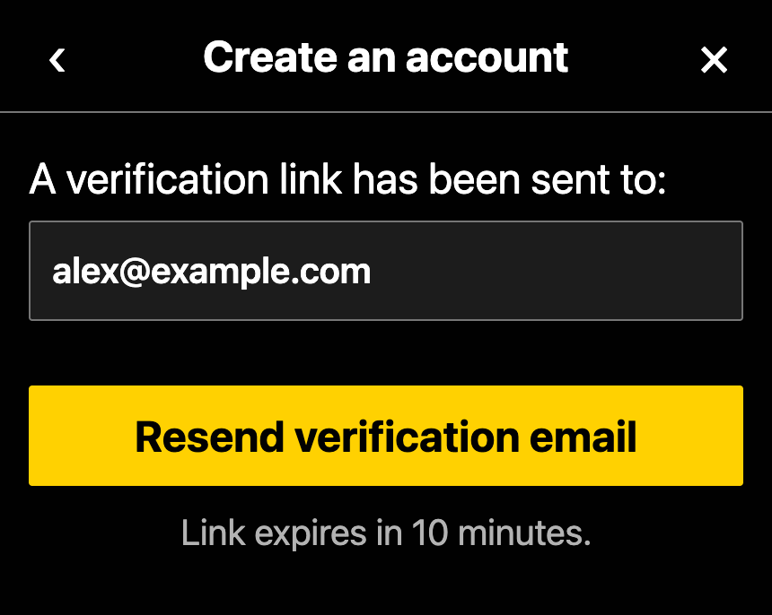 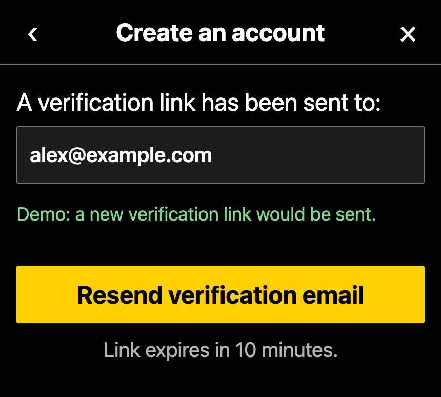

The "check your inbox" screen after sign-up. Feedback is a polite live region and joins the
reading order only while shown.

| Prop | Type | Description |
| :-- | :-- | :-- |
| `email` | `string` | Address shown. |
| `isLoadingUser` | `boolean` | When `email` is empty: `true` shows "Loading email address", `false` shows "Email unavailable". |
| `isResending` | `boolean` | Disables Resend and changes its label. |
| `message` | `{ type: "error" \| "success"; text: string } \| null` | Feedback text. |
| `onBack`, `onClose`, `onResend` | `() => void` | |

All props are required.

**Source:** [`auth/VerifyEmailContent.tsx`](auth/VerifyEmailContent.tsx)

### EventDetails

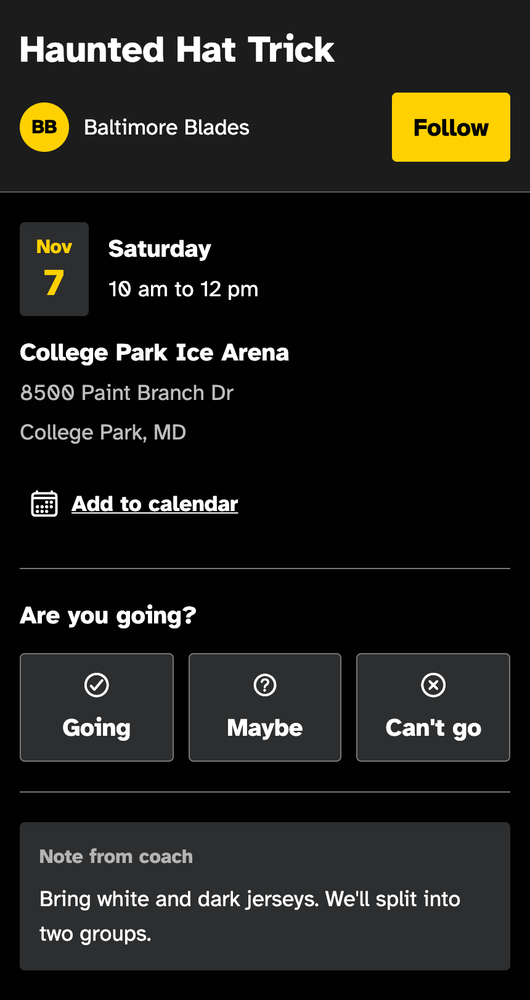

`EventHeader`, `EventDateTime`, `EventLocation`, an Add to calendar link, `RsvpSection`, and
`EventNote`, in reading order.

| Prop | Type | Description |
| :-- | :-- | :-- |
| `event` | `EventWithId` | Uses `title`, `startTime`, `endTime`, `location`, `notes`. |
| `teamName` | `string` | |
| `onAddToCalendar` | `() => void` | |

All props are required. Follow and RSVP state is local (`useState`) and not saved yet.

**Source:** [`events/EventDetails.tsx`](events/EventDetails.tsx)

`auth/CreateAccountForm.tsx` (the sign-up flow) isn't documented here because it takes no props
and calls Firebase directly.

## Building the Figma screens

Every screen on the Figma Hi-Fi Screens page (`456:15`) can be put together from this library.
Screen backgrounds are `bg-black`, page padding is 16 px (20 px on chat screens), and the bottom
tabs are [`TabBarButton`](#tabbarbutton-tabbaricon-tabbarlabel).

| Figma | Screens | Components |
| :-- | :-- | :-- |
| Registration | 1100–1110 Welcome | `AuthButton`, `AppButton variant="outline"` (Sign up), `AppText` |
| | 1200 Invite | `TeamBadge`, `InviteMessage`, `InviteActions` |
| | 1300–1310 Sign up, 5100–5120 Login | `AuthHeader`, `AuthTextField`, `PasswordField`, `AuthButton`, `OrDivider`, `AuthLinkButton`, `AuthErrorBanner` |
| | 1400 Verify email | `VerifyEmailContent` |
| | 2100 Account type | `AuthHeader`, `AppText variant="h2"`, `AppButton variant="outline"` |
| | 2200–3500 Your / Child's / Parent's info | `ScreenHeader` (back + close), `StepProgress`, `PhotoButton` + `ActionSheet`, `AuthTextField` (`readOnly` for a known email), `SelectField`, `ToggleCard`, `AuthButton` |
| | 4100 Join or make | `AuthButton`, `AppButton variant="outline"` |
| | 4200 Find a team | `TeamHeader`, `SearchField`, `TeamListRow` |
| | 4300 Team detail | `TeamHeader`, `TeamInfoCard`, `AppButton` |
| | 4400 / 4600 Request sent | `SuccessBadge` + `RequestSentMessage`, or `CenteredMessage` |
| | 4500–4530 Create team | `ScreenHeader`, `AuthTextField`, `SelectField`, `RangeSlider`, `AuthButton` |
| Login | 5200–5500 Forgot / new password | `ScreenHeader` (back), `AuthTextField`, `PasswordField`, `AuthErrorMessage`, `AuthButton`, `AuthLinkButton align="center"`, `CenteredMessage` |
| Home | 6100–6200 For You, Discover | `HomeHeader`, `AppText variant="h1"`, `SearchField variant="filled"`, `SegmentedControl`, `SectionHeader`, `EventCard`, `TeamCard` |
| | 6300, 6600 See all | `ScreenHeader divider="none"`, `FilterChip`, `EventCard`, `TeamCard` |
| | 6400–6430 Event details | `EventDetails` (or `EventHeader`, `EventDateTime`, `EventLocation`, `RsvpSection`, `EventNote`) |
| | 6450–6452 Coach event details, Edit note, Replies | `ScreenHeader` (trailing "Edit"), `EventHeader`, `EventDateTime`, `EventLocation`, `RsvpReplies`, `EventNote label="Note for players" onEdit`, `AuthTextField multiline` |
| | 6500–6530 New event, Date, Time, Location | `ScreenHeader`, `AuthTextField` (`multiline` note), `PickerField`, `Calendar`, `SegmentedControl size="compact"`, `SearchField`, `SectionHeader size="medium"`, `ListRow` |
| | 6700–6900 Notifications | `ScreenHeader divider="none"`, `FilterChip`, `NotificationCard`, `AnnouncementHeader`, `EventCard`, `AppButton variant="outline" svgIcon={ChatIcon}` |
| Chat | 7100–7130 Channels | `ChatListHeader`, `TeamSwitcherMenu`, `TabStrip`, `ChannelCard`, `CenteredMessage` |
| | 7200 Messages | `ChatListHeader`, `TabStrip`, `AppButton size="compact"`, `ConversationRow` |
| | 7210–7211 New message | `ScreenHeader` ("< Cancel"), `AlertBanner`, `Chip`, `SearchField`, `SectionHeader size="muted"`, `ListRow` with `selected` / `unselected`, `AppButton size="compact"` |
| | 7220, 7300 Conversation, channel | `ConversationHeader`, `DateDivider`, `MessageBubble`, `ChannelMessage`, `MessageComposer` |
| | 7310–7311 Channel info, notifications | `ScreenHeader`, `ChannelIdentity`, `SectionHeader size="small"`, `ListGroup`, `ListRow`, `RadioCard`, `ChoiceButton`, `AppButton size="compact"` |
| Account | 8100 Account | `AppText variant="h2"`, `PhotoButton`, `ListRow` (settings), `AuthButton` |
| | 8110–8171 Edit name, gender, age, email, phone, hockey #, location | `ScreenHeader` ("Cancel", large title), `AuthTextField` (`readOnly` current email), `SelectField`, `PasswordField`, `ToggleCard`, `AuthErrorMessage`, `VerifyEmailContent`, `AuthButton` |

## Formatting helpers

Pure functions in [`events/eventFormat.ts`](events/eventFormat.ts), used for both display and speech.

| Function | Example |
| :-- | :-- |
| `getEventWhen(start, end)` | `{ weekday: "Saturday", monthShort: "Nov", day: "7", timeRange: "10 am to 12 pm", spoken: "Saturday, November 7, 10 AM to 12 PM" }` |
| `splitLocation(location)` | `{ name: "College Park Ice Arena", details: ["8500 Paint Branch Dr", "College Park, MD"], spoken: "…" }` |
| `getInitials(name)` | `"Baltimore Blades"` → `"BB"` |

## Adding a component

1. Put it in the feature folder (`auth/`, `team/`, `teams/`, `events/`, `invite/`, `home/`, `notifications/`, `chat/`), or `ui/` if it's app-wide. Add it to [Building the Figma screens](#building-the-figma-screens) if a screen uses it.
2. Use the color and type tokens. No raw hex values and no text below `text-small` (16.5 px).
3. Make touch targets at least 48 px. Hide decorative icons when the text beside them says the same thing.
4. Add the screen-reader props using the helpers in `@/components/accessibility`:
   - Extend `ScreenReaderStopProps` or `ScreenReaderControlProps`, or `ScreenReaderProps` with a typed `screenReaderParts` for several stops.
   - Spread `useScreenReaderProps({ hideFromScreenReader, screenReaderOrder })` on the outer element.
   - On each control, spread `skipFocusProps(hideFromScreenReader)` and use `onPress={withPressAnnouncement(onPress, screenReaderPressAnnouncement)}`.
   - Add it to [`screenReaderProps.test.tsx`](screenReaderProps.test.tsx).
5. Add a section here with a screenshot (430 px wide, @2x, in `docs/images/components/`), props, and an example.
6. Run `npx jest --runInBand` and `npx tsc --noEmit`, and check it with VoiceOver or TalkBack.

## Notes

- Some screenshots predate the 2026-11-22 Figma alignment and need re-rendering. The components added on 2026-11-23 have no screenshots yet.
- The invite components use `font-['AtkinsonHyperlegibleBold']` instead of `font-sans-bold` because `app/invite/index.tsx` loads the fonts under those names. Keep them.
- `TeamIcon`, `eventFormat`, and `TeamBadge` each have their own initials helper.
- Intentional differences from the Figma Style Guide: 4 px corner radius (Style Guide says 8 px), 60 px headers with a rule instead of the 56 px `Header` component, Atkinson Hyperlegible on the date tile instead of Source Sans Pro, and a yellow outline on the current RSVP reply while editing.
- Intentional differences from the hi-fi screens (2026-11-23):
  - Home, notification, and account screens set some text in Source Sans Pro (22 px titles, 18 px labels). The library uses Atkinson Hyperlegible and the nearest type-scale step (`h3` 21/30, 18 px).
  - Chat placeholders are `#757575` on `#1C1C1C` in Figma (about 3.9:1 contrast). Every field uses `#BDBDBD` instead.
  - The closed `SelectField` keeps its chevron on the right, as in the open dropdown and account screens; some registration frames put it right after "Select".
  - Header back buttons on the Home sub-screens are 30 px icons with no padding in Figma; `ScreenHeader` gives every action a 48 px target.
  - The toggle card's description is Source Sans Pro 16 px in Figma; the library uses `text-small` (16.5 px, the floor).
